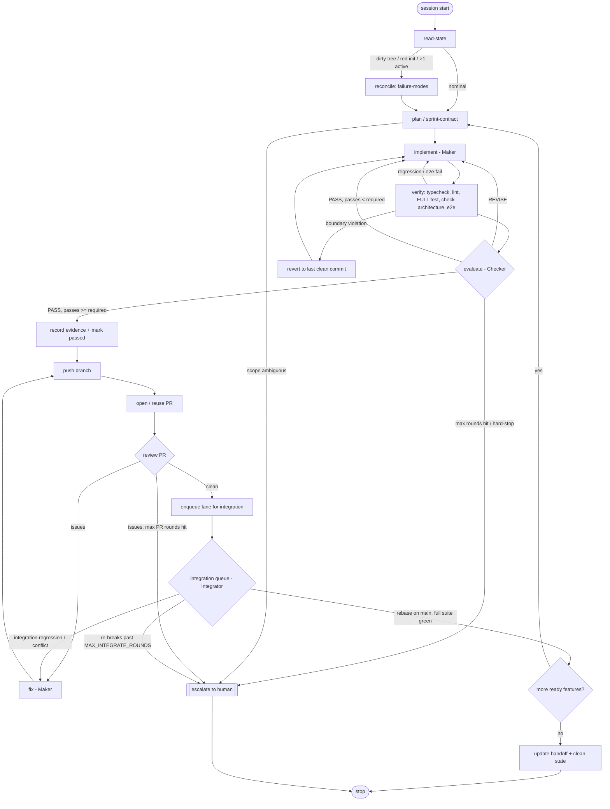
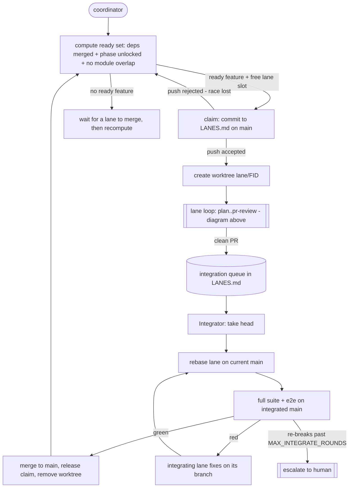

# Workflow Graph

The maker-checker loop, drawn. A graph is not a new invention here; it is what the loop
becomes once it has branches, rollbacks, and a human escape hatch. This is the authoritative
execution model: nodes are steps, edges are transitions, and routing rules decide the next
node from shared state. `graph.json` is the machine-readable twin.

## Diagram



This is one lane's loop (and the whole picture when `MAX_LANES=1`). `read-state` now also loads
`LANES.md`, and the first step of a fresh lane is **claim** (below). A clean PR no longer merges
directly — it enqueues, and the Integrator merges lanes to `main` one at a time.

## Parallel mode (`MAX_LANES > 1`)



The two gates that keep parallel safe map to two nodes: **claim** (the git-mutex that stops a
feature being dropped or double-owned) and the **Integrator** serializing merges with a full
re-run on the integrated `main` (the cross-feature regression gate). Lanes run the diagram
above concurrently; only integration is serialized. Details: `loops/parallel-loop.md`,
`loops/integration-loop.md`.

## Nodes
| Node | Responsibility | Input | Output | Type | Model / effort |
|---|---|---|---|---|---|
| read-state | Load PROJECT_STATE, LANES, CURRENT_TASK, sprint contract; check start invariants | `.harness/*` | lane + active feature + context | code (deterministic) | — |
| claim | Claim a ready feature by committing to `LANES.md` on `main`; create `lane/<FID>` worktree (parallel mode) | ready set, free slot | owned feature + worktree | code (deterministic, git-mutex) | — |
| repair | Reconcile an abnormal start state (`loops/failure-modes.md`) | dirty tree / red init / bad lane invariants | clean, one-active-per-lane baseline | agent | sonnet / medium |
| plan | Fix "done": write/confirm sprint contract (incl. lane ownership) | active feature, docs | signed sprint-contract | agent (Planner) | opus / high |
| implement | Build the thinnest step, produce evidence | sprint contract | code + evidence | agent (Maker) | sonnet / medium |
| verify | Run typecheck, lint, FULL suite (regression gate), check-architecture, e2e; capture output | code | check results | code (deterministic) | — |
| evaluate | Score against rubric, re-run checks | code + evidence + results | score + verdict | agent (Checker) | opus / high |
| record | Write evidence, set status passed | verdict PASS | updated ROADMAP + progress | code + agent | sonnet / low |
| push | Push branch to origin | committed evidence | branch on remote | code (deterministic) | — |
| open-pr | Open PR if none exists, else reuse | branch on remote | PR number/url | code (deterministic) | — |
| pr-review | Review the PR diff: code-review pass + separate fresh-context simplicity pass | PR | findings or clean | agent (Checker) | opus / high |
| pr-fix | Address PR findings (and integration regressions) | findings | code + evidence | agent (Maker) | sonnet / medium |
| enqueue | Add the lane to the `LANES.md` integration queue on a clean PR | clean PR | lane queued | code (deterministic) | — |
| integrate | Merge queued lanes to `main` one at a time: rebase, full suite + e2e on integrated main, merge, release claim | queue | updated `main` | agent (Integrator) + code | sonnet / medium |
| rollback | Revert to last clean commit on hard violation | dirty tree | clean tree | code (deterministic) | — |
| handoff | Rewrite PROJECT_STATE, run clean-state checklist | slice complete | clean, documented repo | agent | sonnet / low |
| escalate | Stop and write a human-readable alert | blocker | alert in PROJECT_STATE | agent | sonnet / low |

Model / effort is guidance with a default, not a rule: judgment nodes (plan, evaluate,
pr-review) get the most capable tier at high effort; mechanical nodes a mid tier; broad
read-only exploration the fastest tier; `—` nodes are deterministic code and need no model.
Use tier aliases (`opus`/`sonnet`/`haiku` or your tool's equivalent), never pinned model ids.

## Edges
| From | To | Type | Condition |
|---|---|---|---|
| read-state | claim | conditional | parallel mode, lane has no feature yet, ready set non-empty |
| claim | plan | standard | claim committed to main (push accepted) + worktree ready |
| claim | claim | loop | push rejected (race lost) — rebase, pick another ready feature |
| read-state | plan | standard | start state nominal, lane already owns a feature |
| read-state | repair | conditional | dirty tree, red init, or lane invariants violated |
| repair | plan | standard | baseline clean + one active feature per lane |
| plan | implement | standard | contract signed |
| plan | escalate | conditional | scope/acceptance ambiguous |
| implement | verify | standard | step complete |
| verify | evaluate | standard | checks ran |
| verify | implement | rollback | regression in a COMPLETE feature, or e2e/edge test fails |
| verify | rollback | rollback | boundary violation detected |
| rollback | implement | standard | tree clean again |
| evaluate | implement | rollback | verdict REVISE, or PASS but consecutivePasses < required |
| evaluate | record | conditional | verdict PASS and consecutivePasses >= required |
| evaluate | escalate | conditional | max rounds hit or hard-stop |
| record | push | standard | always |
| push | open-pr | standard | always |
| open-pr | pr-review | standard | always |
| pr-review | pr-fix | conditional | findings present, prRound < MAX_PR_ROUNDS |
| pr-fix | push | standard | fixes committed (loop) |
| pr-review | enqueue | conditional | clean + CI green |
| pr-review | escalate | conditional | findings present and prRound >= MAX_PR_ROUNDS (checked before pr-fix; a clean review never escalates) |
| enqueue | integrate | standard | always (immediate when MAX_LANES=1) |
| integrate | pr-fix | rollback | integration regression or merge conflict, integrateRound < MAX_INTEGRATE_ROUNDS |
| integrate | plan | conditional | merged green to main, release claim, and a ready feature remains |
| integrate | handoff | conditional | merged green to main and no ready feature remains |
| integrate | escalate | conditional | re-breaks main past MAX_INTEGRATE_ROUNDS |
| handoff | stop | standard | always |
| escalate | stop | standard | always |

## Shared state (every node reads/writes this)
```
laneId                 # this lane (branch/worktree); "single" when MAX_LANES=1
readySet               # claimable features: deps merged + phase unlocked + no module overlap
activeFeatureId        # the feature this lane claimed (from LANES.md / ROADMAP.md)
ownedModules           # paths/modules this lane may touch (no overlap with other active lanes)
startState             # nominal | dirty-tree | red-init | lane-invariant-violation (routes to repair)
sprintContract         # the signed contract for the active feature
codeChanges            # what the Maker produced this round
verifyResults          # typecheck/lint/FULL-test/check-architecture/e2e output
regressionDetected     # a COMPLETE feature's test went red this round
e2eVerdict             # PASS | FAIL | N/A (not user-facing)
evaluatorVerdict       # PASS | REVISE
evaluatorScore         # avg + per-criterion
consecutivePasses      # counter toward REQUIRED_PASSES
round                  # current round; guarded by MAX_ROUNDS
standingDefects        # open defects from the Checker
prRound                # current PR review round; guarded by MAX_PR_ROUNDS
prFindings             # open findings from the last PR review
prVerdict              # CLEAN | ISSUES
integrationQueue       # ordered lanes awaiting merge to main (LANES.md)
integrateRound         # current integration round for the head lane; guarded by MAX_INTEGRATE_ROUNDS
integratedMainVerdict  # GREEN | RED (full suite + e2e on main after rebase+merge)
```
Concrete values live across `ROADMAP.md`, `LANES.md` (laneId, readySet, ownedModules,
integrationQueue, integrateRound), `verification/sprint-contract.md`, and
`loops/loop-state.md` (round, consecutivePasses, standingDefects — per lane). The graph does
not add a new store. `prRound`/`prFindings`/`prVerdict` live as prose in each round's
`## PR Review — round N` section of `.harness/reviews/<FID>-review.md`; move them into
`loop-state.md` if a cold agent ever needs to resume mid-PR-round.

## Routing rules (plain if-then, the execution logic)
```
if parallel and lane unclaimed and readySet non-empty -> claim (commit to main)
if claim push rejected (race)             -> rebase, recompute readySet, claim again
if claim accepted                         -> create worktree -> plan
if read-state finds dirty tree/red init/bad lane invariants -> repair (failure-modes) -> plan
if verify detects boundary violation      -> rollback
if verify finds a regression or e2e/edge failure -> implement (fix, round++)
if verify passed                          -> evaluate
if evaluate == REVISE                     -> implement (round++)
if evaluate == PASS and passes <  required -> implement (round++)
if evaluate == PASS and passes >= required -> record
if record                                 -> push -> open-pr -> pr-review
if pr-review has findings and prRound >= MAX_PR_ROUNDS -> escalate (checked first)
if pr-review finds findings               -> pr-fix -> push (prRound++)
if pr-review clean                        -> enqueue -> integrate
if integrate rebase+merge greens main     -> release claim; readySet left? plan : handoff
if integrate reds main or conflicts, integrateRound < MAX_INTEGRATE_ROUNDS -> pr-fix (round++)
if integrate re-breaks past MAX_INTEGRATE_ROUNDS -> escalate
if round >= MAX_ROUNDS or hard-stop       -> escalate
if plan finds scope ambiguous             -> escalate
```

## Why draw it
Two payoffs. First, the branches (rollback on violation, escalate on max-rounds, the
consecutive-pass gate) are explicit instead of buried in an agent's judgment, so the loop
behaves the same every run. Second, it is the seed of real graph-runner orchestration later
(LangGraph-style) if you automate beyond a single agent: these nodes and edges map straight
onto it.
