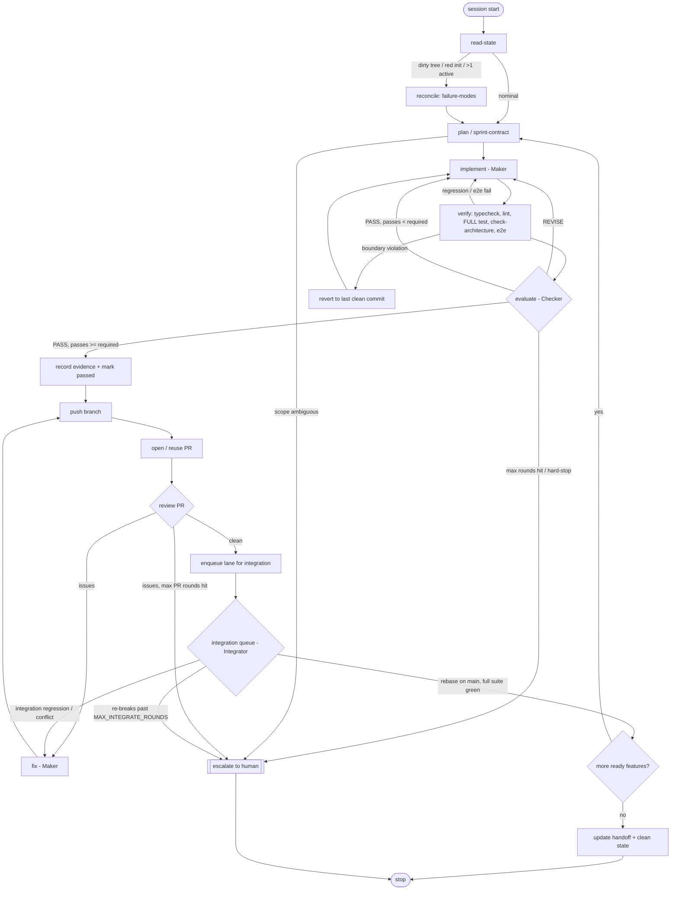
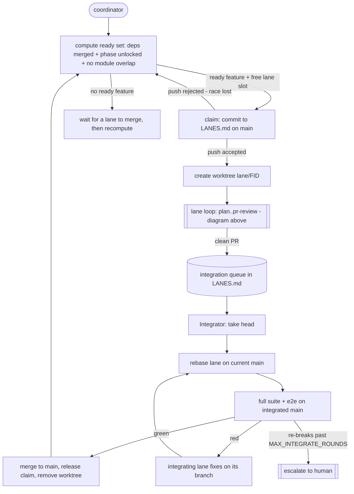

# HARNESS-BOOTSTRAP — portable closed-loop build harness

This one file recreates a complete, project-neutral `.harness/` in any repository:
the **loops** (maker-checker, PR-review, timer, goal) and their **failure modes**, the
**workflow graph**, the **roles + rubric + evidence** discipline with a first-class
**e2e requirement + edge-case battery**, the **rules + scripts contracts**, the
**tracking system** (state/roadmap/task/changelog/decisions/blockers), and
**runtime continuity**. It also ships an **opt-in parallel mode** — concurrent build
**lanes** (git worktrees) coordinated by a git-native **claim ledger** so no feature is
dropped or double-claimed, and an **integration queue** that merges lanes to `main` one at a
time with a full re-run so no lane breaks another. It ships **no requirement** — the product
vision, the roadmap
features, the phases and the architecture are left as empty placeholders you fill in
after scaffolding.

## How to use

**Agent path (recommended).** Drop this file at the root of the target repo and tell your
coding agent:

> Read `HARNESS-BOOTSTRAP.md` at the repo root and scaffold the harness: create every file it
> defines verbatim at the path in its `FILE:` header (content between `<<<BEGIN` and `END>>>`),
> making directories as needed. Don't clobber anything that already exists. Leave every
> `<<FILL: …>>` placeholder exactly as written — I'll add the product, roadmap, and
> architecture later. Do NOT fill the architecture files or write `layer-boundaries.md` yet;
> that waits until I give you the requirement (`check-architecture` stays a no-op until then).
> When done, run the Self-check below and report the counts, then delete this bootstrap file.

**Manual path.** Each block below is a complete file. Copy the text between `<<<BEGIN`
and `END>>>` into the file named in the `FILE:` header.

## Preconditions & safety (the bootstrap is idempotent)

Before writing anything, the agent checks these and adapts — a failed precondition degrades
gracefully, it does not abort the scaffold:

- **Existing `.harness/`** — do NOT clobber. If a file already exists, leave it and report
  the skip. Only create what is missing. (Re-running this file must be safe.)
- **Git repo** — if the target isn't a git repo, run `git init` first (the loop needs
  commits). If there's no `origin` remote or no `gh` CLI, still scaffold, but note that the
  **PR-review loop is inert until a remote + `gh` exist**; maker-checker + local verify still
  run fully.
- **Default branch** — detect it (`git symbolic-ref --short HEAD`, or `main`/`master`); use
  that name everywhere the docs say `main`.
- **Toolchain** — leave `CLAUDE.md → Commands` as `<placeholders>` unless the repo's manifest
  makes the real commands obvious; never guess a package manager into the docs.

## Self-check (prove the scaffold end-to-end)

After creating the tree, verify the bootstrap actually landed — don't assume:

1. Every `FILE:` path in this document exists on disk (**41 files**).
2. No file still contains the literal `<<<BEGIN` / `END>>>` delimiters (a transcription leak).
3. `graph/graph.json` parses as JSON.
4. Machinery files contain **no** `<<FILL: …>>` markers; only the 9 requirement files +
   `CLAUDE.md` Commands + `AGENTS.md` Tech-stack + the three first-run tracking files do.
   (`LANES.md` + the two parallel-loop files are machinery — no `<<FILL>>`; parallel mode is
   opt-in and ships off, `MAX_LANES=1`.)

Report the counts. Then delete this bootstrap file.

## What you fill in afterward ("the requirement")

Nothing project-specific is written at scaffold time. When you bring the requirement, fill
these — and only these:

**The product + scope (always):**
- `.harness/product/PRODUCT.md`, `.harness/product/PERSONAS.md`
- `.harness/ROADMAP.md` (+ one `phases/PHASE-01-*.md` per phase) — include each feature's
  `deps:` and the **parallel plan** (which features run at once vs. which chain sequentially).
- `.harness/rules/scope-guard.md` (the in-scope / off-limits lists from the ROADMAP)

Parallel mode is **machinery, nothing to fill** — it ships off (`MAX_LANES=1` in `LANES.md`),
behaving exactly like the single-feature loop. To turn it on, set `MAX_LANES > 1` and make sure
your ROADMAP deps are accurate; the ready set and the lane/integration loops do the rest.

**The architecture — deferred, and shaped to the project type:**
- `.harness/architecture/ARCHITECTURE.md` + `MODULES.md`, then encode the real import rules in
  `.harness/rules/layer-boundaries.md`.
- `.harness/architecture/DATA_MODEL.md` + `API_SURFACE.md` **only if the archetype has them**
  (a DevOps/IaC or pure-automation repo often marks them N/A).
- Start from the closest shape in `.harness/architecture/ARCHETYPES.md` (full-stack app /
  DevOps-IaC / Airflow-data-pipeline) — that file ships filled in, as guidance.
- Until you write real boundaries, **`check-architecture` is a no-op**, so the loop runs from
  feature one with no architecture yet. Writing the rules flips it to an enforcing gate.

**The toolchain + first run:** set `.harness/CLAUDE.md` → Commands to your commands,
`.harness/AGENTS.md` → Tech stack, then write the first `.harness/PROJECT_STATE.md` +
`.harness/CURRENT_TASK.md` + `loops/loop-state.md`. Everything else is machinery and stays
as-is.

## Tree this produces

```
.harness/
├── README.md                 # what the harness is + read order
├── AGENTS.md                 # operating contract (the rules)  ── machinery
├── CLAUDE.md                 # session bootstrap checklist      ── machinery (Commands = fill)
├── RUNTIME-CONTINUITY.md     # two-runtime failover on limits   ── machinery
├── RUNTIME-SWITCHES.md       # runtime switch ledger (empty)
├── PROJECT_STATE.md          # MASTER: where we are (skeleton)
├── ROADMAP.md                # features × phases (FILL)
├── CURRENT_TASK.md           # the one active feature (skeleton)
├── CHANGELOG.md              # completed-with-evidence history (skeleton)
├── DECISIONS.md              # decision log (skeleton)
├── BLOCKERS.md               # known blockers (skeleton)
├── LANES.md                   # parallel lanes + claim ledger + integration queue (skeleton)
├── loops/
│   ├── goal.md               # single-goal iterate-to-done loop     ── machinery
│   ├── maker-checker-loop.md # build/verify cycle, no human         ── machinery
│   ├── pr-review-loop.md     # gate next feature on a clean PR       ── machinery
│   ├── parallel-loop.md      # spawn/claim/run concurrent lanes       ── machinery
│   ├── integration-loop.md   # merge-queue: lanes -> main one at a time ── machinery
│   ├── timer-loop.md         # scheduled health heartbeat            ── machinery
│   ├── failure-modes.md      # how the loop handles abnormal states  ── machinery
│   └── loop-state.md         # live loop state, per-lane (reset template)
├── graph/
│   ├── workflow-graph.md     # the loop drawn: nodes/edges/routing   ── machinery
│   └── graph.json            # machine-readable twin                 ── machinery
├── verification/
│   ├── roles.md              # planner / maker / checker separation  ── machinery
│   ├── evaluator-rubric.md   # the 5-criterion score gate            ── machinery
│   ├── acceptance-evidence.md# what counts as evidence (incl. e2e)   ── machinery
│   ├── edge-cases.md         # the standard edge-case battery        ── machinery
│   └── sprint-contract.md    # per-feature contract (blank template)
├── rules/
│   ├── conventions.md        # ids/git/evidence/session hygiene      ── machinery
│   ├── scope-guard.md        # phase leash (frame kept, body FILL)
│   └── layer-boundaries.md   # import rules (frame kept, body FILL)
├── scripts/
│   └── SCRIPTS.md            # init/check/logger/… contracts         ── machinery
├── state/
│   └── clean-state-checklist.md                                      ── machinery
├── product/
│   ├── PRODUCT.md            # (FILL)
│   └── PERSONAS.md           # (FILL)
└── architecture/
    ├── ARCHETYPES.md         # 3 project shapes to fill from         ── machinery
    ├── ARCHITECTURE.md       # (FILL — after requirement)
    ├── DATA_MODEL.md         # (FILL — optional by archetype)
    ├── API_SURFACE.md        # (FILL — optional by archetype)
    ├── MODULES.md            # (FILL — after requirement)
    └── decisions/
        └── ADR-template.md   # generic ADR template                 ── machinery
```

Statuses used everywhere: `NOT STARTED` · `IN PROGRESS` · `BLOCKED` · `IN REVIEW` ·
`COMPLETE` · `DEPRECATED`. Feature ids are `F001`, `F002`, … Branches are `feat/<FID>`
(or `docs/<slug>`/`chore/<slug>` for harness-only work). `IN PROGRESS` is **per lane**: with
`MAX_LANES=1` (the default) there is exactly one, which is the classic single-feature loop;
with parallel mode on, each lane owns one. Lanes are git worktrees named `lane/<FID>`; the
claim ledger + integration queue live in `LANES.md` (`loops/parallel-loop.md`).

═══════════════════════════════════════════════════════════════════════════════════════
                                    MACHINERY
═══════════════════════════════════════════════════════════════════════════════════════

FILE: .harness/README.md
<<<BEGIN
# Project Harness

This is the **harness** for building this project. A harness gives the model a closed-loop
working system so it builds the right thing, verifies its own work, and — through the
persistent tracking system below — survives across sessions without relying on
conversation history.

**There is no application code here.** This folder is a persistent tracking system +
rules + specs. A coding agent reads it, then writes the app one verified feature at a time.

## Read order (every session starts here)
1. `PROJECT_STATE.md` — **MASTER FILE.** Where the project is. Read this before anything.
2. `CURRENT_TASK.md` — the one feature to work on next.
3. `ROADMAP.md` — all features across the phases, with status.
4. The active `phases/PHASE-XX-*.md` — acceptance criteria.
5. `DECISIONS.md` + `BLOCKERS.md`, then inspect the real code.

## Layout
```
.harness/
├── PROJECT_STATE.md   # MASTER: where we are (read first)
├── ROADMAP.md         # all phases/features + status (source of truth for scope)
├── CURRENT_TASK.md    # the one feature in progress + next step
├── CHANGELOG.md       # completed-implementation history (evidence)
├── DECISIONS.md       # decision log (indexes the ADRs)
├── BLOCKERS.md        # known blockers
├── AGENTS.md          # operating contract (the rules)
├── CLAUDE.md          # session bootstrap checklist
├── RUNTIME-CONTINUITY.md # runtime failover on session limits
├── RUNTIME-SWITCHES.md   # runtime switch ledger
├── phases/            # PHASE-01..N — feature defs + acceptance criteria
├── product/           # PRODUCT.md, PERSONAS.md (the vision)
├── architecture/      # ARCHITECTURE, DATA_MODEL, API_SURFACE, MODULES + decisions/ (ADRs)
├── rules/             # layer-boundaries, scope-guard, conventions
├── verification/      # roles, evaluator-rubric, sprint-contract, acceptance-evidence
├── loops/             # goal, timer, maker-checker, pr-review + loop-state
├── graph/             # workflow-graph (+ json) — the loop, drawn
└── scripts/           # SCRIPTS.md — automation contracts (specs, not code)
```

## The tracking system (why it exists)
The project must not depend on chat history to know what's done. `PROJECT_STATE.md`
answers "where am I?", `ROADMAP.md` answers "where am I going?", `CURRENT_TASK.md`
answers "what do I do now?". After implementing and verifying, the agent updates the
tracking files and picks the next task. A brand-new session can enter the repo and
continue with no prior context.

## The idea in one line
Rules-first entry points (`AGENTS.md`/`CLAUDE.md`/`rules/`), an agent-readable workspace
(this tree), multi-session continuity (the tracking files), runtime feedback + scope
control (`rules/` + `scripts/`), self-verification + role separation (`verification/`),
automated loops (`loops/`), and the workflow drawn as a graph (`graph/`).
END>>>

FILE: .harness/AGENTS.md
<<<BEGIN
# AGENTS.md — Operating Contract

You are a coding agent building this project. This file overrides your defaults. Read it
fully. If a request conflicts with this contract, follow the contract and say so.

## What this project is
See `product/PRODUCT.md` for the vision and `architecture/ARCHITECTURE.md` for the shape.
Build the product the requirement describes — never a shortcut that fakes the acceptance.

## Read this order, every session (before touching code)
1. `PROJECT_STATE.md` — MASTER FILE. Where the project is right now.
2. `LANES.md` — which lanes exist, what each has claimed, the integration queue. Identify
   **which lane you are** (your worktree/branch) before anything, or that you are the single
   default lane. Skip only if parallel mode is off (`MAX_LANES=1`) and you are in the main tree.
3. `CURRENT_TASK.md` — your lane's one feature and its exact next step.
4. `ROADMAP.md` — all features across the phases, with status + deps.
5. The active phase file under `phases/` — acceptance criteria for the current feature.
6. `DECISIONS.md` + `BLOCKERS.md` — what's decided, what's stuck.
7. **Then inspect the actual code.** The codebase is the source of truth for what EXISTS;
   the tracking files are the source of truth for intended state + history. If they
   disagree: inspect, correct the tracking files, and note the discrepancy in `CHANGELOG.md`.

## The ten rules
1. **Tracking before memory.** Never rely on conversation history. The `.harness/`
   tracking files are the state of the project. Read them first; update them before you stop.
2. **One feature at a time — per lane.** Each lane works exactly one feature that is
   `IN PROGRESS` (its row in `LANES.md`, detailed in that lane's `CURRENT_TASK.md`). Do not
   start the next in your lane until the current one is verified. With `MAX_LANES=1` this is
   the single global active feature. Across lanes: never touch a feature another lane has
   claimed, and claim before you build (`loops/parallel-loop.md` — the claim is a commit to
   `main`, which is the mutex). No feature is ever `IN PROGRESS` with zero or two owners.
3. **No victory without evidence.** A feature is `COMPLETE` only when every acceptance
   criterion in its phase file is met AND verification is recorded in `CHANGELOG.md`:
   happy path + the applicable `verification/edge-cases.md` battery + error paths + the FULL
   suite green (no regressions) + an e2e test for any user-facing flow
   (`verification/acceptance-evidence.md`). "It should work" is not evidence.
4. **Respect layer boundaries.** Obey `rules/layer-boundaries.md`. Cross-layer imports are
   a defect. `check-architecture` enforces this and a violation blocks "done".
5. **Stay in scope + phase.** `rules/scope-guard.md` lists what is off-limits for the
   current phase. Phases are gated (ROADMAP order). Don't build a later phase's features now.
6. **Modular and expandable.** New types, importers, exporters, and actions register
   against interfaces (`architecture/MODULES.md`); they do not edit the core. If adding a
   feature forces a core edit that a registry should handle, the abstraction is wrong.
7. **Separate maker from checker.** After implementing (maker), switch to the Evaluator
   role (`verification/roles.md`) and score honestly against `verification/evaluator-rubric.md`.
   You may not approve your own work by assertion.
8. **Persist state every session.** Before stopping, update `PROJECT_STATE.md`,
   `CURRENT_TASK.md`, `ROADMAP.md` (+ the phase file), and `CHANGELOG.md`; open/close
   anything in `BLOCKERS.md`; record decisions in `DECISIONS.md`. See `rules/conventions.md`
   and the Session-completion protocol below.
9. **Small, reversible steps.** Thinnest vertical slice that is demonstrable. Commit per
   feature on `feat/<FID>` (or `docs/<slug>`/`chore/<slug>` for harness-only work,
   `rules/conventions.md`) with the message format in `rules/conventions.md`. No drive-by
   refactors. After a feature passes: push, open/reuse a PR, review it, and fix findings
   until clean (`loops/pr-review-loop.md`); then hand the lane to the **integration queue**
   (`loops/integration-loop.md`) — a clean PR is not merged ad hoc. Start your lane's next
   feature only once the current one is queued (or merged). A feature is not done until it is
   merged to `main` with the full suite + e2e green **on the integrated main**.
10. **Observability is not optional.** Structured logs at startup, boundaries, and errors
    (`scripts/SCRIPTS.md` → logger). If you can't see why it failed, add a log before you
    add a fix.

## Statuses (use ONLY these)
`NOT STARTED` · `IN PROGRESS` · `BLOCKED` · `IN REVIEW` · `COMPLETE` · `DEPRECATED`.
No "almost done", "mostly working", "probably fine".

## The loop you run
```
read PROJECT_STATE + CURRENT_TASK + ROADMAP + phase file  ->  confirm the ONE IN PROGRESS feature
  ->  write/confirm sprint-contract  ->  implement (Maker)
  ->  verify (CLAUDE.md Commands: typecheck, lint, FULL tests, check-architecture, e2e)
  ->  score as Checker (evaluator-rubric; edge-cases battery; no regressions)
  ->  pass? record evidence in CHANGELOG, mark COMPLETE in ROADMAP + phase file
      fail? log defects, revise, repeat (bounded rounds)
  ->  push branch, open/reuse PR, review it (code-review, loops/pr-review-loop.md)
      clean? enqueue the lane for integration (loops/integration-loop.md), then claim next ready feature
      issues? fix (Maker), commit, push, review again (bounded rounds)
  ->  update PROJECT_STATE + LANES + CURRENT_TASK + BLOCKERS  ->  stop cleanly
```
The explicit version, with routing rules, is `graph/workflow-graph.md`.

## Parallel lanes (opt-in — `MAX_LANES` in `LANES.md`; default 1)
A **lane** is one build stream: a git worktree + a `lane/<FID>` branch + one active feature.
`MAX_LANES=1` is the classic single-feature loop and the default; set it higher to run
features concurrently. Two invariants make parallel safe:
- **No missing / double-claimed feature.** A feature becomes `IN PROGRESS` only by a lane
  **claiming** it — a one-line commit to `LANES.md` on `main`. Git is the mutex: if two lanes
  race, the second push is rejected, it rebases, sees the feature taken, and claims another
  from the ready set. Every `IN PROGRESS` feature has exactly one lane; every lane has exactly
  one. Only features in the **ready set** (all deps `COMPLETE` **and merged to main**, phase
  unlocked, no module overlap with an active lane — `rules/scope-guard.md`) are claimable.
- **No lane breaks another.** Lanes never merge to `main` ad hoc. A clean PR puts the lane in
  the **integration queue** (`loops/integration-loop.md`): the Integrator merges one lane at a
  time — rebase on current `main`, resolve conflicts, re-run the FULL suite + e2e **on the
  integrated main**, and only a green integrated main lets the next lane in. A per-lane green
  PR is necessary but not sufficient; the cross-feature regression gate is at integrate.
See `loops/parallel-loop.md` (spawn/claim/run) and `loops/integration-loop.md` (merge queue).

## Definition of done (per feature)
- Every acceptance criterion in the phase file met.
- Applicable edge/error cases (`verification/edge-cases.md`) covered by tests.
- FULL suite green — no regression in any previously COMPLETE feature (regression gate).
- E2E test passes for every user-facing flow (or contract says "N/A — not user-facing").
- Verification recorded in `CHANGELOG.md` (reproducible command/output or artifact path).
- No layer-boundary violation (`check-architecture` passes).
- Evaluator score >= threshold (`verification/evaluator-rubric.md`).
- `ROADMAP.md` + phase file marked `COMPLETE`; `PROJECT_STATE.md` + `CURRENT_TASK.md`
  updated; committed on `feat/<FID>` (or `docs/<slug>`/`chore/<slug>` for harness-only work).
- Branch pushed, PR opened/reused, reviewed clean, CI (incl. e2e) green, no unresolved
  findings (`loops/pr-review-loop.md`).
- Merged to `main` through the integration queue with the FULL suite + e2e green **on the
  integrated main** (`loops/integration-loop.md`), and the lane's claim released in `LANES.md`.
  (With `MAX_LANES=1` the queue is trivial — the lane merges, then releases.)

When the state is not nominal (dirty tree, red baseline, regression, flaky test, CI drift,
merge conflict, committed secret, blocked feature, a double-claimed or orphaned lane, an
integration regression), follow `loops/failure-modes.md` — each has a defined response.

## Session-completion protocol (do all of this before you stop)
1. Determine exactly what was implemented and run the appropriate tests.
2. Update the feature status (phase file) and phase status.
3. Update `ROADMAP.md` (checkbox + counts) and your lane's `CURRENT_TASK.md`.
4. Update `PROJECT_STATE.md` (current phase/feature, progress, last verified, git commit) and
   your lane's row in `LANES.md` (round, status, queue position).
5. Add a `CHANGELOG.md` entry (feature ID + evidence).
6. If the feature just went `COMPLETE`: push the branch, open (or reuse) its PR, review it,
   and fix findings until clean (`loops/pr-review-loop.md`); then **enqueue the lane for
   integration** (`loops/integration-loop.md`). Only after it merges green on main do you
   release the claim and let the lane take its next feature.
7. Update `BLOCKERS.md` and `DECISIONS.md` if anything changed.
8. Record git branch/commit (or `Working tree: DIRTY`) in `PROJECT_STATE.md`.
9. Clearly set the next task in `CURRENT_TASK.md`. If you are ending the lane (no next ready
   feature), release its claim in `LANES.md` and leave the worktree clean for removal.

## Usage / session limits
When you hit a usage or session limit, do not just stop: run the Session-completion
protocol above (commit + update the tracker), then fail over to the other runtime per
`RUNTIME-CONTINUITY.md`. The next runtime resumes from `PROJECT_STATE.md`.

## Hard stops (ask a human)
- A change would delete user data or break a public API contract.
- Scope/acceptance is ambiguous and the files don't resolve it.
- Maker-checker has failed the same feature for the max rounds (`loops/loop-state.md`).
- An integration-queue merge keeps re-breaking `main` past `MAX_INTEGRATE_ROUNDS`, or two
  lanes have a conflict neither can own without redesign (`loops/integration-loop.md`).

## Tech stack
<<FILL: the locked stack for this project — languages, frameworks, datastore, package
manager. Keep it here so every session honors the same choices. No dependency that isn't
justified by the active feature.>>
END>>>

FILE: .harness/CLAUDE.md
<<<BEGIN
# CLAUDE.md — Session Bootstrap

Quick reference. `AGENTS.md` is the full contract; this is the checklist you run every session.

## On session start (in order)
1. Read `PROJECT_STATE.md` — the master file. Where we are.
2. Read `LANES.md` — the lanes, the claim ledger, the integration queue. Know which lane you
   are (or that you are the single default lane, `MAX_LANES=1`).
3. Read your lane's `CURRENT_TASK.md` — the one feature + its exact next step.
4. Read `ROADMAP.md` — the feature list + statuses + deps + the parallel plan.
5. Read the active phase file under `phases/` — acceptance criteria.
6. Read `DECISIONS.md` + `BLOCKERS.md`.
7. Run `init` (see `scripts/SCRIPTS.md`) to confirm a clean baseline.
8. **Inspect the actual code.** Never trust the tracking files blindly — the codebase is
   the truth for what exists. If they disagree, correct the tracking files and note it in
   `CHANGELOG.md`.

## The one rule you break most often
Work the ONE feature your lane has `IN PROGRESS`. Evidence before you move on. Don't "quickly
also add" the next thing, and never touch a feature another lane claimed in `LANES.md`.

## Where things live
| I need to know... | Read |
|---|---|
| Where the project is right now | `PROJECT_STATE.md` (master) |
| Which lanes exist / what's claimed / the queue | `LANES.md` |
| What to do next | my lane's `CURRENT_TASK.md` |
| The whole feature list + status + deps + parallel plan | `ROADMAP.md` |
| How lanes are spawned/claimed and merged | `loops/parallel-loop.md`, `loops/integration-loop.md` |
| Acceptance for the current feature | the active `phases/PHASE-XX-*.md` |
| What's been shipped | `CHANGELOG.md` |
| What's decided (don't relitigate) | `DECISIONS.md` (+ `architecture/decisions/` ADRs) |
| What's stuck | `BLOCKERS.md` |
| Why / for whom | `product/PRODUCT.md`, `product/PERSONAS.md` |
| How it's structured / the data shape | `architecture/ARCHITECTURE.md`, `DATA_MODEL.md` |
| What I may import | `rules/layer-boundaries.md` |
| What's off-limits now | `rules/scope-guard.md` |
| How I prove it works | `verification/evaluator-rubric.md`, `acceptance-evidence.md` |
| The edge cases I must cover | `verification/edge-cases.md` |
| What to do when state is abnormal | `loops/failure-modes.md` |

## Commands
<<FILL: replace with your toolchain. These are the exact commands `init`, the loops, and
the Checker run. Keep this table current — it's the first thing the next agent needs.>>

| Action | Command |
|---|---|
| Install | `<install>` |
| Dev server | `<dev>` |
| Typecheck | `<typecheck>` |
| Lint | `<lint>` |
| Test (full suite) | `<test>` |
| E2E | `<e2e>` (real-stack end-to-end; runs in CI) |
| Build | `<build>` |
| Verify baseline | `./scripts/init.sh` (install + build + typecheck + lint + full test + check-architecture + e2e smoke) |
| Check boundaries | `<check-architecture>` (`scripts/check-architecture.sh`) |
| Progress % | see `scripts/SCRIPTS.md` → progress-counter |
| Lane (worktree) ops | `lane claim\|list\|release\|remove` (`scripts/SCRIPTS.md` → lane; parallel mode) |
| Integrate queued lanes | `integrate` (`scripts/SCRIPTS.md` → integrate; parallel mode) |

## Current target
<<FILL: the active phase + feature, e.g. "Phase 01 — Foundation. Feature F001." Details
live in `CURRENT_TASK.md`.>>

## Before you stop
Run the Session-completion protocol in `AGENTS.md`: update PROJECT_STATE, LANES (your row),
your lane's CURRENT_TASK, ROADMAP (+ phase file), CHANGELOG, BLOCKERS/DECISIONS as needed;
leave the tree clean (`state/clean-state-checklist.md`); commit on `feat/<FID>` (or
`docs/<slug>`/`chore/<slug>` for harness-only work). If the feature just went COMPLETE: push,
open/reuse the PR, review it, fix findings until clean (`loops/pr-review-loop.md`), then
enqueue the lane for integration (`loops/integration-loop.md`) — don't merge ad hoc. Start the
lane's next feature only once the current one is queued/merged.
END>>>

FILE: .harness/loops/goal.md
<<<BEGIN
# Goal Loop

The first step from manual driving to automation: hand the agent a goal with a hard finish
line and let it iterate until done or a stop condition trips. Use this to complete a single
feature (or slice) without babysitting.

## Contract
```
GOAL:        <one feature or slice, e.g. "F001 passes">
DONE WHEN:   every acceptance item in the phase file for this feature is met
             AND evidence recorded AND Evaluator PASS (>=4.0, no 1s)
VERIFY WITH: the FULL verify (CLAUDE.md → Commands: typecheck + lint + full test +
             check-architecture + e2e) + the feature's edge/error tests + its sprint-contract checks
STOP AFTER:  15 turns  OR  90 minutes  OR  3 consecutive Evaluator REVISEs on the same defect
CONSTRAINTS: obey scope-guard.md; one feature only (this lane's claimed feature); no new deps
             without contract justification; never mark passed without evidence; never edit
             .harness rules to make a check pass; stay inside this lane's owned modules (LANES.md);
             on any abnormal state (dirty tree, red init, regression, flaky test) follow failure-modes.md
ON STOP:     update ROADMAP.md + CHANGELOG.md + PROJECT_STATE.md, commit, report why it stopped
```

## How it runs each turn
1. Read state (PROJECT_STATE, CURRENT_TASK, sprint contract).
2. Advance the feature by the smallest demonstrable step.
3. Run VERIFY. Capture output as evidence.
4. Switch to Evaluator, score against the rubric.
5. PASS -> record evidence, mark passed, exit loop. REVISE -> log defect, continue.
6. Check stop conditions. If tripped, do ON STOP and halt for human review.

## Notes
- The goal must be *verifiable*, not aspirational. "Make it nice" is not a goal;
  "F009 acceptance met" is.
- The loop does not get to redefine DONE. That is fixed by the feature's acceptance +
  sprint contract.
- If it stops on turns/time rather than success, that is useful data, not failure — it
  means the feature was mis-sized or blocked. Note which in PROJECT_STATE.md.
END>>>

FILE: .harness/loops/maker-checker-loop.md
<<<BEGIN
# Maker-Checker Loop

A self-contained build/verify cycle that needs no human in the round. The Maker implements;
the Checker (a separate invocation, so it cannot see the Maker's rationalizations) verifies
against acceptance + rubric; feedback loops back until N consecutive passes or max rounds.
This is `roles.md` turned into an automated cycle, and it is the loop `graph/workflow-graph.md`
draws.

## Components

### Maker prompt (skeleton)
```
You are the Maker. Implement ONLY this lane's claimed feature (your row in .harness/LANES.md;
the single active one in .harness/ROADMAP.md when MAX_LANES=1). Stay inside the modules your
lane owns — do not edit another lane's files.
Read: AGENTS.md, the feature's sprint-contract.md, architecture docs, layer-boundaries.md,
scope-guard.md. Build the thinnest step that advances the feature. Produce the evidence
each acceptance item needs. Obey boundaries and scope. Do NOT grade your own work. Do NOT
mark the feature passed. Output: what you changed, the exact commands to reproduce evidence,
any contract deviation.
```

### Checker prompt (skeleton)
```
You are the Checker. You did not write this code. Do not trust the Maker's summary.
Re-run every verification command yourself: the FULL suite (not a subset), check-architecture,
and the e2e test for any user-facing flow. Score against .harness/verification/evaluator-rubric.md.
Check acceptance completeness, correctness (probe the applicable .harness/verification/edge-cases.md
categories the Maker skipped; confirm error paths and no regression in COMPLETE features),
boundary+scope compliance, modularity, evidence quality. Look for the skipped item, the empty
assertion, the boundary leak, the flaky/mocked-away e2e. Output: the scored block + verdict
PASS|REVISE. On REVISE, list specific defects tied to acceptance items / rubric lines with the
failing evidence. Do not fix code.
```

### State file
`loop-state.md` — tracks round number, what the Maker changed, the Checker verdict +
defects, and the consecutive-pass counter.

## Cycle
```
round r:
  Maker implements  ->  writes evidence + change summary  ->  updates loop-state
  Checker re-runs checks  ->  scores  ->  verdict
    PASS   -> consecutivePasses++ ; if >= REQUIRED_PASSES -> mark feature passed, exit
    REVISE -> consecutivePasses=0 ; record defects ; Maker addresses them next round
  if r >= MAX_ROUNDS -> stop, escalate to human with the standing defects
```

## Parameters (defaults; tune per feature in loop-state.md)
- `REQUIRED_PASSES = 2` consecutive Checker PASSes (guards against a fluke green).
- `MAX_ROUNDS = 6`.
- Escalate immediately (do not spend rounds) on: a boundary violation the Maker keeps
  reintroducing, or a request that needs a human decision (a hard-stop in AGENTS.md).

## Why a separate Checker invocation
If the same context grades itself, it inherits the Maker's blind spots and its motivation
to be done. A cold Checker re-running the commands is the whole point. When run inside one
session, switch context hard and re-run — do not "remember" that it worked.
END>>>

FILE: .harness/loops/pr-review-loop.md
<<<BEGIN
# PR Review Loop

Runs after maker-checker passes and `record` writes evidence. Local checks + a self-scored
rubric are not the same as a diff a reviewer actually looked at. This loop closes that gap:
it gates moving to the next feature on a clean PR, not just a clean local run.

## Cycle
```
after record (feature passed maker-checker):
  push branch to origin
  open a PR if none exists for this branch (reuse if one does — never open a second)
  review the PR (code-review; a Checker-style pass over the diff, not self-grading)
    CLEAN  -> enqueue this lane in LANES.md integration queue (loops/integration-loop.md)
    ISSUES -> fix (Maker) -> commit -> push (same branch/PR) -> review again
  if issues persist for MAX_PR_ROUNDS -> escalate to human with standing findings
```
A clean PR does **not** merge here — it hands off to the integration queue, which merges lanes
to `main` one at a time and re-runs the full suite on the integrated main (the cross-feature
regression gate). With `MAX_LANES=1` the queue has one entry and this is immediate.

## Components

`<branch>` is `feat/<FID>` for a ROADMAP feature, or `docs/<slug>`/`chore/<slug>` for
harness-only tooling work (`rules/conventions.md`'s branch-naming exception). `<name>` is
the FID, or the branch's slug for harness-only work.

### Push
`git push -u origin <branch>` (plain `git push` once upstream is set). Never force-push a
shared branch.

### Open / reuse PR
`gh pr create --base main --head <branch> --title "<type>(<scope>): <desc>"` — title
follows the commit convention (`rules/conventions.md`). Body is the write-up at
`.harness/reviews/<name>-PR.md` — write that file first, pass it as `--body-file`. Check
`gh pr list --head <branch>` before creating; if one is open, push updates to it instead.

### Review
Run a Checker-style `code-review` pass against the branch/PR diff. Same principle as the
Checker in `maker-checker-loop.md`: it must not just trust the Maker's summary of its own
diff. Record findings in `.harness/reviews/<name>-review.md`.

### Fix
Findings get addressed as the Maker, committed, and pushed to the same branch — never a new
PR, never a force-push. Then review again.

## Parameters
- `MAX_PR_ROUNDS = 4` (a round here is push+review+fix, not a full maker-checker cycle —
  keep it separate from `MAX_ROUNDS` in `maker-checker-loop.md`).

## Gate
A lane's next feature does not start until this feature's PR is clean **and CI is green** (the
full suite + e2e in CI, which is authoritative — see `loops/failure-modes.md` "local green, CI
red") **and the lane has been enqueued for integration**. This is `AGENTS.md` rule 2 ("one
feature at a time, per lane") extended past the local check to the PR — a feature that passed
maker-checker but has an open PR with unresolved findings, red CI, or an unmerged integration
is not done. Other lanes keep running their own features in parallel meanwhile.

## Conflicts with the default branch
If the branch falls behind and conflicts, rebase (or merge) the default branch in, re-run the
full suite + e2e locally, then push — never force-push a shared branch (`failure-modes.md`).

## Why after record, not before
Maker-checker already proves correctness + evidence locally. Doing the PR after `record`
means every PR opened describes a feature already proven, not a WIP diff — the PR review is
one more independent pass (real CI checks, a fresh look at the diff), not a substitute for
the local one.
END>>>

FILE: .harness/loops/parallel-loop.md
<<<BEGIN
# Parallel Loop — concurrent build lanes (opt-in)

The single-feature loop (`maker-checker-loop.md`, `graph/workflow-graph.md`) is the default.
This file is how you run several of those loops at once **without dropping or double-claiming a
feature, and without lanes breaking each other**. It is off until you set `MAX_LANES > 1` in
`LANES.md`; at `MAX_LANES=1` everything here collapses to the classic loop and you can ignore it.

## What a lane is
A **lane** = one git worktree + a `lane/<FID>` branch + exactly one claimed feature + its own
`CURRENT_TASK.md` / `loop-state.md` / sprint contract on that branch. Lanes run the whole
per-feature loop independently and concurrently (one runtime/agent each is typical). The only
serialized step is integration (`integration-loop.md`).

## The two invariants (this is the whole point)
1. **No missing / double-claimed feature.** A feature goes `IN PROGRESS` only via a **claim**,
   and a claim is a commit to `LANES.md` on `main`. Git is the mutex.
2. **No lane breaks another.** Lanes own disjoint modules and never merge ad hoc; the Integrator
   serializes merges and re-runs the full suite on the integrated `main`.

## Coordinator (what picks work for lanes)
```
loop:
  ready = lane ready            # deps merged to main + phase unlocked + unclaimed + module-disjoint
  if free lane slot (active lanes < MAX_LANES) and ready non-empty:
      pick a ready feature (respect phase order; prefer unblockers of the most dependents)
      claim it (below); on success spawn a lane, on race retry with the next ready feature
  else if no ready feature: wait for a lane to merge (which grows the ready set), then recompute
  stop when every feature is COMPLETE and merged
```
The coordinator can be a human assigning lanes, a script, or the lead agent. It owns no code; it
only claims and spawns.

## Claim protocol (the git-mutex)
```
claim <FID>:
  git fetch; git switch main; git pull --rebase
  re-read LANES.md: is <FID> still in the ready set and unclaimed?  no -> abort, pick another
  append the claim line to LANES.md (FID | lane/FID | owner | owned-modules | claimed-at)
  set ROADMAP <FID> -> IN PROGRESS
  commit ("chore(lanes): claim <FID>") and push
    push rejected (someone claimed first) -> pull --rebase, re-check; <FID> taken -> pick another
    push accepted -> the claim is yours
  git worktree add ../wt-<FID> -b lane/<FID> main
```
Two lanes racing for the same feature cannot both win: one push lands, the other is rejected and
backs off. No lock server, no out-of-band coordination — just `main`.

## Running a lane
Each lane runs `graph/workflow-graph.md` on its worktree: read-state -> plan (sprint contract,
incl. §0 owned modules) -> implement -> verify -> evaluate -> record -> push -> PR review. Stay
inside the lane's owned modules. On a clean, CI-green PR the lane **enqueues** for integration
(`integration-loop.md`) instead of merging, then — once merged — releases its claim and either
claims the next ready feature or ends (worktree removed).

## Choosing what parallelizes
- **Parallel**: features with no dependency between them and disjoint modules (the ready set).
- **Sequential**: a dependency chain — `F003 deps: F001` waits until F001 is *merged*, not just
  passed. Declared in `ROADMAP.md`; enforced by the ready set (`rules/scope-guard.md`).
- **Serialize alone**: anything that must edit the shared/pure core. Give it the whole floor
  (claim it when no other lane overlaps) rather than racing edits into the core.

## Parameters (in `LANES.md`)
- `MAX_LANES` — concurrent lanes (default 1 = off). Keep it <= the number of genuinely
  independent ready features; more lanes than independent work just creates integration churn.
- WIP = active lanes; never exceed `MAX_LANES`.

## Bound it
More lanes is not more throughput past the point where features stop being independent — every
extra lane adds integration/rebase cost and conflict risk. Start at 2–3, raise only if the ready
set is reliably that wide. Abnormal states (claim race, orphaned lane, cross-lane collision) are
handled in `loops/failure-modes.md` → "Parallel lanes".
END>>>

FILE: .harness/loops/integration-loop.md
<<<BEGIN
# Integration Loop — the merge queue (opt-in)

Parallel lanes each prove their own feature on their own branch. That is necessary but **not
sufficient**: two independently-green branches can still break each other once combined. This
loop is the cross-feature regression gate — it merges lanes to `main` **one at a time**, each
with a full re-run on the integrated result, so `main` is never red. Off at `MAX_LANES=1` (a
single clean lane just fast-forwards).

## Why serialize merges
If N lanes merged concurrently, each would test a `main` that none of the others had landed on
yet — exactly the blind spot that lets feature A break feature B. Serializing means every merge
is validated against the real, current `main` including all earlier-merged lanes. One rebase is
ever in flight, so conflicts are pairwise and tractable.

## The queue
Lives in `LANES.md` → `## Integration queue`: an ordered list of lanes whose feature passed
maker-checker and has a clean, CI-green PR. FIFO by default; a lane may be prioritized if it
unblocks the most dependents. A lane enters on its clean PR (`pr-review-loop.md`) and leaves
when merged green or bounced back to fix.

## Cycle (the Integrator role, `verification/roles.md`)
```
while queue non-empty:
  lane = head(queue)
  git switch main; git pull --rebase
  rebase lane/<FID> onto current main
    conflict -> hand back to the lane to resolve on its branch (it owns its code), re-queue; continue
  merge lane into a staging ref (or merge --no-ff into a temp integration branch)
  run the FULL verify on the integrated result: typecheck + lint + FULL suite + check-architecture + e2e
    GREEN -> merge to main (no force-push); mark <FID> COMPLETE in ROADMAP + phase file;
             record evidence in CHANGELOG (incl. "integrated-main suite: green");
             lane release <FID>; lane remove; pop the queue
    RED   -> do NOT merge. integrateRound++. Hand the lane the failing output; it fixes on its
             branch (Maker), re-passes its own PR, and re-queues. The break is a real
             cross-feature defect, not a formality.
  if integrateRound > MAX_INTEGRATE_ROUNDS for this lane -> escalate (AGENTS.md hard stop)
```

## Parameters
- `MAX_INTEGRATE_ROUNDS = 3` — attempts to land one lane before escalating (separate from
  `MAX_ROUNDS` and `MAX_PR_ROUNDS`).

## Who does the fix
The **integrating lane owns the fix**, on its own branch, rebased on current `main` — not the
Integrator patching trunk, and never a merge that lands red "to be fixed later." The Integrator
coordinates and verifies; it does not write feature code (same separation as Checker vs Maker).

## Interaction with CI
CI on `main` is the authoritative re-run (`loops/failure-modes.md` "local green, CI red"). The
Integrator's local full-suite run gates the merge; CI on `main` confirms it. A post-merge red CI
reverts the offending merge (never force-push) and re-queues the lane.

## Definition of done, completed
A feature is `COMPLETE` only after it lands green here and its claim is released. Passing
maker-checker and a clean PR mean "ready to integrate," not "done" (`AGENTS.md` → Definition of
done). With `MAX_LANES=1` the queue holds one lane and this is immediate, but the rule is the
same: nothing is done until it is green on `main`.
END>>>

FILE: .harness/loops/timer-loop.md
<<<BEGIN
# Timer Loop (Monitoring Heartbeat)

A scheduled, recurring check that watches for problems and fixes the safe ones autonomously,
escalating the rest. Not for building features — for keeping the project healthy between
build sessions. Run every 10–30 minutes while active work is happening, or daily for slower
checks.

## What it checks
```
EVERY 30 min (during active development):
  - does init still run green from a clean state?
  - do typecheck / lint / the FULL test suite pass on the current branch? (regression gate)
  - does the e2e smoke (critical user path) still pass?
  - does check-architecture pass (no new boundary violations)?
  - LANES invariants: each lane has <= 1 IN PROGRESS feature; no feature claimed by two lanes;
    every IN PROGRESS feature has a live lane (no orphan); active lanes own non-overlapping
    modules; the integration queue is advancing (no entry stuck past MAX_INTEGRATE_ROUNDS).
    With MAX_LANES=1 this reduces to "exactly one active feature."
  - does `main` (the integrated trunk) still pass the FULL suite + e2e smoke?

DAILY:
  - dependency audit (known vulns) — report only
  - dead-code / cleanup scan (scripts/SCRIPTS.md -> cleanup-scanner) — report only
  - is PROJECT_STATE.md stale (older than last commit)? flag it
```

## Resolution policy
- **Fix autonomously** (low risk): a formatting/lint failure, a stale handoff timestamp, a
  malformed json trailing comma, a flaky test with an obvious deterministic fix.
- **Report only** (never auto-fix): failing tests with unclear cause, boundary violations,
  dependency vulnerabilities, anything touching the data model or a public contract.
- **Escalate to human**: init won't go green, repeated failures, or a security finding.

## Loop shape
```
tick -> run checks -> classify findings
  -> auto-fixable? fix, verify the fix, log it
  -> report-only?  append to a findings note, do not touch code
  -> escalate?     stop, write a clear human-readable alert in PROJECT_STATE.md
continue at next interval unless disabled or an escalation fired
```

## Stop / control
- Runs indefinitely at its interval until disabled.
- Any escalation pauses the loop for human review.
- Every human intervention is recorded, so we can see whether the loop runs unattended.

## Scheduling note
Schedule this with a real recurring task (a scheduled task / cron), not an in-process timer,
so it survives session end. It reads the same `.harness` state; it is just a different
trigger.

## What the heartbeat runs (make it real, not just typecheck)
```
- init green from clean state
- typecheck + lint + unit/integration tests
- check-architecture (no boundary violations)
- FULL suite, not only the last feature's tests (regression gate)
- e2e smoke: the critical user path(s) still pass end-to-end
- LANES invariants hold (one active feature per lane; no double-claim; no orphan lane;
  non-overlapping ownership; queue advancing) — or just "exactly one active" when MAX_LANES=1
- PROJECT_STATE not stale vs last commit
```
END>>>

FILE: .harness/loops/failure-modes.md
<<<BEGIN
# Failure Modes — how the loop handles abnormal states

The happy loop lives in `maker-checker-loop.md` and `graph/workflow-graph.md`. This file is
what to do when the state is *not* nominal. Each entry is a defined response, not a judgment
call, so the loop behaves the same every run. When one of these fires, note it (CHANGELOG or
BLOCKERS) so a cold agent sees it happened.

## At session start (read-state)
- **Dirty working tree** (uncommitted changes from a prior/other runtime): do NOT build on it
  blind. `git status` + read the diff; reconcile against `PROJECT_STATE.md`. If it's a
  coherent in-progress step for the active feature, continue it; if it's unknown, stash it to
  a `wip/<date>` branch and note it in `BLOCKERS.md`. Never discard without recording.
- **`init` is red**: fixing it IS the first task — before any feature work. A red baseline
  invalidates every downstream check.
- **More `IN PROGRESS` features than lanes** (invariant violation): each lane owns at most one.
  With `MAX_LANES=1` there must be exactly one — keep the one matching `PROJECT_STATE.md`, set
  the others to their true status. With parallel on, reconcile `ROADMAP.md` against `LANES.md`:
  every `IN PROGRESS` feature must map to exactly one live lane. Note the fix in `CHANGELOG.md`.
- **Tracking vs code disagree**: the codebase is truth for what EXISTS; correct the tracking
  files and note the discrepancy (`AGENTS.md`).
- **Phase / dependency gate not met**: the active feature depends on an incomplete earlier
  one, or its phase isn't unlocked. Don't build ahead — mark it BLOCKED with the dependency,
  or correct the active feature to the real next one (`scope-guard.md`).

## During build (implement / verify)
- **Regression in a previously COMPLETE feature**: the FULL suite (not just this feature's
  tests) must stay green. A regression is a hard defect — fix it as part of this feature or
  revert the change; never mark passed with a red full suite. This is the **regression gate**.
- **Boundary violation**: `rollback` to the last clean commit, then re-implement within
  bounds (graph rollback edge). If the Maker reintroduces the same violation, escalate — do
  not spend rounds.
- **No clean commit to roll back to** (first feature, nothing green yet): reset the offending
  change by hand to the last compiling state; if none exists, the feature was started wrong —
  re-plan the thinnest slice.
- **Flaky test**: a re-run that goes green is not a pass. Confirm the non-determinism, find
  the root cause (timing, ordering, shared state, real clock/network/random), fix it
  deterministically, and record the fix. Quarantining without a fix is a REVISE.
- **Secret / `.env` / generated artifact staged**: stop, unstage, add to `.gitignore`; if it
  was ever committed, rotate the secret and scrub history. A committed secret is a
  clean-state red flag and a hard stop.

## At the gate (evaluate / record / PR)
- **Checker PASS you don't trust**: re-run cold in a clean checkout. Trust the reproduced
  command, not the memory that it worked.
- **Local green, CI red**: environment drift (native deps, DB, env vars, runtime version). CI
  is authoritative for full verification — reconcile to CI, don't override it. Reinstall /
  rebuild native deps for the platform (`RUNTIME-CONTINUITY.md`).
- **Branch conflicts with the default branch**: rebase (or merge) it into the feature branch,
  re-run the full suite + e2e, then push. Never force-push a shared branch.
- **PR findings persist past `MAX_PR_ROUNDS`**: escalate with the standing findings; do not
  keep looping or silently merge.

## Parallel lanes (only when `MAX_LANES > 1`)
- **Claim race (two lanes grabbed the same feature)**: the claim is a commit to `LANES.md` on
  `main`, so one lane's push wins and the other is rejected non-fast-forward. The loser does
  `git pull --rebase`, sees the feature now claimed, drops it, and claims another from the
  ready set. If both somehow recorded a claim, the earlier commit wins; the later lane aborts,
  resets its worktree, and re-claims. Never two owners.
- **Orphaned lane (a runtime died mid-feature)**: a lane in `LANES.md` with no commit on its
  branch for a long gap and no live runtime. Inspect its branch: if there is salvageable work,
  a new lane adopts the branch and continues; otherwise release the claim (feature back to the
  ready set) and remove the worktree. Record it. An abandoned claim must never pin a feature.
- **Cross-lane module collision**: a lane edited a file another active lane owns (ownership in
  `LANES.md` / the sprint contract). Stop — this is how lanes break each other. Revert the
  stray edit; if the feature genuinely needs that shared/core module, it is **not** parallel-
  safe: serialize it (claim the core lock / run it alone) rather than editing across lanes.
- **Integration regression (a lane greens its own PR but reds the integrated `main`)**: the
  merge exposed a cross-feature conflict the per-lane suite couldn't see. The **integrating
  lane owns the fix** on its branch (rebased on main), re-runs the full suite on the integrated
  result, and only then does the merge land. It does not go in red. See `integration-loop.md`.
- **Merge conflict at integrate**: the integrating lane rebases on current `main` and resolves,
  re-running the full suite + e2e after. Lanes merge one at a time, so only one rebase is ever
  in flight. Persisting past `MAX_INTEGRATE_ROUNDS` escalates (a hard stop in `AGENTS.md`).
- **Dependency not yet merged**: a ready-set feature's dep is `COMPLETE` on a branch but not on
  `main`. It is **not** ready — "done" means merged. Wait for the dep to clear the queue, or
  pick another ready feature. Building on an unmerged dep is building on sand.

## Anytime
- **BLOCKED**: record it in `BLOCKERS.md` (what would unblock it), set the feature status
  BLOCKED, then either pick up an unblocked/ready feature in the same phase or stop cleanly —
  never fake progress around a blocker.
- **Usage / session limit**: run the Session-completion protocol and fail over
  (`RUNTIME-CONTINUITY.md`). Never stop mid-edit with a dirty tree. In parallel mode a limit
  pauses that one lane; other lanes keep running.
- **Scope temptation**: park it in `BLOCKERS.md` / `ROADMAP.md`; stay on the active feature.
END>>>

FILE: .harness/loops/loop-state.md
<<<BEGIN
# Loop State

Live state for the maker-checker loop. Overwrite the "Current" block each round; append
finished features to History. A cold agent reads this to know which round it is on. The
active feature also lives in `../CURRENT_TASK.md`; keep them consistent.

**Per lane.** This file is the state of ONE lane's loop. With `MAX_LANES=1` there is one, in
the main tree. In parallel mode each worktree carries its own `loop-state.md` on its branch —
`LANES.md` on `main` is the cross-lane index; this is the lane's own detail. Set `Lane` below.

## Parameters (current feature)
- Lane: <<FILL: lane id/branch, e.g. lane/F001 — or "single" when MAX_LANES=1>>
- Feature: <<FILL: first feature id, e.g. F001 — <name>>>
- REQUIRED_PASSES: 2
- MAX_ROUNDS: 6

## Current
- Round: 0
- consecutivePasses: 0
- Last Maker change: none (harness scaffolded)
- Last Checker verdict: none
- Standing defects: none
- Next action: write the sprint contract for the first feature

## History
```
(feature id | rounds used | final verdict | date)
--- none yet ---
```

## Escalations
```
(date | feature | reason | resolution)
--- none yet ---
```
END>>>

FILE: .harness/graph/workflow-graph.md
<<<BEGIN
# Workflow Graph

The maker-checker loop, drawn. A graph is not a new invention here; it is what the loop
becomes once it has branches, rollbacks, and a human escape hatch. This is the authoritative
execution model: nodes are steps, edges are transitions, and routing rules decide the next
node from shared state. `graph.json` is the machine-readable twin.

## Diagram



This is one lane's loop (and the whole picture when `MAX_LANES=1`). `read-state` now also loads
`LANES.md`, and the first step of a fresh lane is **claim** (below). A clean PR no longer merges
directly — it enqueues, and the Integrator merges lanes to `main` one at a time.

## Parallel mode (`MAX_LANES > 1`)



The two gates that keep parallel safe map to two nodes: **claim** (the git-mutex that stops a
feature being dropped or double-owned) and the **Integrator** serializing merges with a full
re-run on the integrated `main` (the cross-feature regression gate). Lanes run the diagram
above concurrently; only integration is serialized. Details: `loops/parallel-loop.md`,
`loops/integration-loop.md`.

## Nodes
| Node | Responsibility | Input | Output | Type |
|---|---|---|---|---|
| read-state | Load PROJECT_STATE, LANES, CURRENT_TASK, sprint contract; check start invariants | `.harness/*` | lane + active feature + context | code (deterministic) |
| claim | Claim a ready feature by committing to `LANES.md` on `main`; create `lane/<FID>` worktree (parallel mode) | ready set, free slot | owned feature + worktree | code (deterministic, git-mutex) |
| repair | Reconcile an abnormal start state (`loops/failure-modes.md`) | dirty tree / red init / bad lane invariants | clean, one-active-per-lane baseline | agent |
| plan | Fix "done": write/confirm sprint contract (incl. lane ownership) | active feature, docs | signed sprint-contract | agent (Planner) |
| implement | Build the thinnest step, produce evidence | sprint contract | code + evidence | agent (Maker) |
| verify | Run typecheck, lint, FULL suite (regression gate), check-architecture, e2e; capture output | code | check results | code (deterministic) |
| evaluate | Score against rubric, re-run checks | code + evidence + results | score + verdict | agent (Checker) |
| record | Write evidence, set status passed | verdict PASS | updated ROADMAP + progress | code + agent |
| push | Push branch to origin | committed evidence | branch on remote | code (deterministic) |
| open-pr | Open PR if none exists, else reuse | branch on remote | PR number/url | code (deterministic) |
| pr-review | Review the PR diff (code-review) | PR | findings or clean | agent (Checker) |
| pr-fix | Address PR findings (and integration regressions) | findings | code + evidence | agent (Maker) |
| enqueue | Add the lane to the `LANES.md` integration queue on a clean PR | clean PR | lane queued | code (deterministic) |
| integrate | Merge queued lanes to `main` one at a time: rebase, full suite + e2e on integrated main, merge, release claim | queue | updated `main` | agent (Integrator) + code |
| rollback | Revert to last clean commit on hard violation | dirty tree | clean tree | code (deterministic) |
| handoff | Rewrite PROJECT_STATE, run clean-state checklist | slice complete | clean, documented repo | agent |
| escalate | Stop and write a human-readable alert | blocker | alert in PROJECT_STATE | agent |

## Edges
| From | To | Type | Condition |
|---|---|---|---|
| read-state | claim | conditional | parallel mode, lane has no feature yet, ready set non-empty |
| claim | plan | standard | claim committed to main (push accepted) + worktree ready |
| claim | claim | loop | push rejected (race lost) — rebase, pick another ready feature |
| read-state | plan | standard | start state nominal, lane already owns a feature |
| read-state | repair | conditional | dirty tree, red init, or lane invariants violated |
| repair | plan | standard | baseline clean + one active feature per lane |
| plan | implement | standard | contract signed |
| plan | escalate | conditional | scope/acceptance ambiguous |
| implement | verify | standard | step complete |
| verify | evaluate | standard | checks ran |
| verify | implement | rollback | regression in a COMPLETE feature, or e2e/edge test fails |
| verify | rollback | rollback | boundary violation detected |
| rollback | implement | standard | tree clean again |
| evaluate | implement | rollback | verdict REVISE, or PASS but consecutivePasses < required |
| evaluate | record | conditional | verdict PASS and consecutivePasses >= required |
| evaluate | escalate | conditional | max rounds hit or hard-stop |
| record | push | standard | always |
| push | open-pr | standard | always |
| open-pr | pr-review | standard | always |
| pr-review | pr-fix | conditional | findings present, prRound < MAX_PR_ROUNDS |
| pr-fix | push | standard | fixes committed (loop) |
| pr-review | enqueue | conditional | clean + CI green |
| pr-review | escalate | conditional | findings present and prRound >= MAX_PR_ROUNDS (checked before pr-fix; a clean review never escalates) |
| enqueue | integrate | standard | always (immediate when MAX_LANES=1) |
| integrate | pr-fix | rollback | integration regression or merge conflict, integrateRound < MAX_INTEGRATE_ROUNDS |
| integrate | plan | conditional | merged green to main, release claim, and a ready feature remains |
| integrate | handoff | conditional | merged green to main and no ready feature remains |
| integrate | escalate | conditional | re-breaks main past MAX_INTEGRATE_ROUNDS |
| handoff | stop | standard | always |
| escalate | stop | standard | always |

## Shared state (every node reads/writes this)
```
laneId                 # this lane (branch/worktree); "single" when MAX_LANES=1
readySet               # claimable features: deps merged + phase unlocked + no module overlap
activeFeatureId        # the feature this lane claimed (from LANES.md / ROADMAP.md)
ownedModules           # paths/modules this lane may touch (no overlap with other active lanes)
startState             # nominal | dirty-tree | red-init | lane-invariant-violation (routes to repair)
sprintContract         # the signed contract for the active feature
codeChanges            # what the Maker produced this round
verifyResults          # typecheck/lint/FULL-test/check-architecture/e2e output
regressionDetected     # a COMPLETE feature's test went red this round
e2eVerdict             # PASS | FAIL | N/A (not user-facing)
evaluatorVerdict       # PASS | REVISE
evaluatorScore         # avg + per-criterion
consecutivePasses      # counter toward REQUIRED_PASSES
round                  # current round; guarded by MAX_ROUNDS
standingDefects        # open defects from the Checker
prRound                # current PR review round; guarded by MAX_PR_ROUNDS
prFindings             # open findings from the last PR review
prVerdict              # CLEAN | ISSUES
integrationQueue       # ordered lanes awaiting merge to main (LANES.md)
integrateRound         # current integration round for the head lane; guarded by MAX_INTEGRATE_ROUNDS
integratedMainVerdict  # GREEN | RED (full suite + e2e on main after rebase+merge)
```
Concrete values live across `ROADMAP.md`, `LANES.md` (laneId, readySet, ownedModules,
integrationQueue, integrateRound), `verification/sprint-contract.md`, and
`loops/loop-state.md` (round, consecutivePasses, standingDefects — per lane). The graph does
not add a new store. `prRound`/`prFindings`/`prVerdict` live as prose in each round's
`## PR Review — round N` section of `.harness/reviews/<FID>-review.md`; move them into
`loop-state.md` if a cold agent ever needs to resume mid-PR-round.

## Routing rules (plain if-then, the execution logic)
```
if parallel and lane unclaimed and readySet non-empty -> claim (commit to main)
if claim push rejected (race)             -> rebase, recompute readySet, claim again
if claim accepted                         -> create worktree -> plan
if read-state finds dirty tree/red init/bad lane invariants -> repair (failure-modes) -> plan
if verify detects boundary violation      -> rollback
if verify finds a regression or e2e/edge failure -> implement (fix, round++)
if verify passed                          -> evaluate
if evaluate == REVISE                     -> implement (round++)
if evaluate == PASS and passes <  required -> implement (round++)
if evaluate == PASS and passes >= required -> record
if record                                 -> push -> open-pr -> pr-review
if pr-review has findings and prRound >= MAX_PR_ROUNDS -> escalate (checked first)
if pr-review finds findings               -> pr-fix -> push (prRound++)
if pr-review clean                        -> enqueue -> integrate
if integrate rebase+merge greens main     -> release claim; readySet left? plan : handoff
if integrate reds main or conflicts, integrateRound < MAX_INTEGRATE_ROUNDS -> pr-fix (round++)
if integrate re-breaks past MAX_INTEGRATE_ROUNDS -> escalate
if round >= MAX_ROUNDS or hard-stop       -> escalate
if plan finds scope ambiguous             -> escalate
```

## Why draw it
Two payoffs. First, the branches (rollback on violation, escalate on max-rounds, the
consecutive-pass gate) are explicit instead of buried in an agent's judgment, so the loop
behaves the same every run. Second, it is the seed of real graph-runner orchestration later
(LangGraph-style) if you automate beyond a single agent: these nodes and edges map straight
onto it.
END>>>

FILE: .harness/graph/graph.json
<<<BEGIN
{
  "name": "build-loop",
  "description": "Maker-checker build loop with opt-in parallel lanes + integration queue. Machine-readable twin of workflow-graph.md.",
  "version": "2.0.0",
  "entry": "read-state",
  "state": [
    "laneId", "readySet", "activeFeatureId", "ownedModules", "startState", "sprintContract",
    "codeChanges", "verifyResults", "regressionDetected", "e2eVerdict",
    "evaluatorVerdict", "evaluatorScore", "consecutivePasses", "round", "standingDefects",
    "prRound", "prFindings", "prVerdict",
    "integrationQueue", "integrateRound", "integratedMainVerdict"
  ],
  "params": { "MAX_LANES": 1, "REQUIRED_PASSES": 2, "MAX_ROUNDS": 6, "MAX_PR_ROUNDS": 4, "MAX_INTEGRATE_ROUNDS": 3 },
  "nodes": [
    { "id": "read-state", "type": "code",  "does": "load PROJECT_STATE, LANES, CURRENT_TASK, sprint contract; check start + lane invariants" },
    { "id": "claim",      "type": "code",  "does": "claim a ready feature by commit to LANES.md on main (git-mutex); create lane/<FID> worktree" },
    { "id": "repair",     "type": "agent", "does": "reconcile abnormal start state (failure-modes.md)" },
    { "id": "plan",       "type": "agent", "role": "Planner",   "does": "write/confirm sprint contract" },
    { "id": "implement",  "type": "agent", "role": "Maker",     "does": "build thinnest step + evidence" },
    { "id": "verify",     "type": "code",  "does": "typecheck, lint, FULL test (regression gate), check-architecture, e2e" },
    { "id": "evaluate",   "type": "agent", "role": "Checker",   "does": "re-run checks, score against rubric" },
    { "id": "record",     "type": "code",  "does": "write evidence, mark feature passed" },
    { "id": "push",       "type": "code",  "does": "push branch to origin" },
    { "id": "open-pr",    "type": "code",  "does": "open PR if none exists, else reuse" },
    { "id": "pr-review",  "type": "agent", "role": "Checker",   "does": "review PR diff (code-review)" },
    { "id": "pr-fix",     "type": "agent", "role": "Maker",     "does": "address PR findings and integration regressions, commit" },
    { "id": "enqueue",    "type": "code",  "does": "add the lane to the LANES.md integration queue on a clean PR" },
    { "id": "integrate",  "type": "agent", "role": "Integrator", "does": "merge queued lanes to main one at a time: rebase, full suite + e2e on integrated main, merge, release claim" },
    { "id": "rollback",   "type": "code",  "does": "revert to last clean commit" },
    { "id": "handoff",    "type": "agent", "does": "rewrite handoff, run clean-state checklist" },
    { "id": "escalate",   "type": "human", "does": "stop and alert a human" },
    { "id": "stop",       "type": "terminal" }
  ],
  "edges": [
    { "from": "read-state", "to": "claim",     "when": "parallel_and_lane_unclaimed_and_ready_set_nonempty" },
    { "from": "claim",      "to": "claim",     "when": "push_rejected_race_lost", "kind": "loop", "note": "rebase, recompute ready set, claim another" },
    { "from": "claim",      "to": "plan",      "when": "claim_committed_and_worktree_ready" },
    { "from": "read-state", "to": "plan",      "when": "start_state_nominal_and_lane_owns_feature" },
    { "from": "read-state", "to": "repair",    "when": "dirty_tree_or_red_init_or_lane_invariant_violation" },
    { "from": "repair",     "to": "plan",      "when": "baseline_clean_one_active_per_lane" },
    { "from": "plan",       "to": "implement", "when": "contract_signed" },
    { "from": "plan",       "to": "escalate",  "when": "scope_ambiguous" },
    { "from": "implement",  "to": "verify",    "when": "step_complete" },
    { "from": "verify",     "to": "rollback",  "when": "boundary_violation", "kind": "rollback" },
    { "from": "rollback",   "to": "implement", "when": "tree_clean" },
    { "from": "verify",     "to": "implement", "when": "regression_or_e2e_or_edge_failure", "kind": "rollback" },
    { "from": "verify",     "to": "evaluate",  "when": "checks_ran" },
    { "from": "evaluate",   "to": "implement", "when": "verdict_revise_or_passes_below_required", "kind": "rollback" },
    { "from": "evaluate",   "to": "record",    "when": "pass_and_passes_at_or_above_required" },
    { "from": "evaluate",   "to": "escalate",  "when": "max_rounds_or_hard_stop" },
    { "from": "record",     "to": "push",      "when": "always" },
    { "from": "push",       "to": "open-pr",   "when": "always" },
    { "from": "open-pr",    "to": "pr-review", "when": "always" },
    { "from": "pr-review",  "to": "escalate",  "when": "findings_present_and_max_pr_rounds", "priority": 1, "note": "checked before pr-fix; a clean review never escalates" },
    { "from": "pr-review",  "to": "pr-fix",    "when": "findings_present_and_below_max_pr_rounds", "kind": "rollback" },
    { "from": "pr-fix",     "to": "push",      "when": "fixes_committed", "kind": "rollback" },
    { "from": "pr-review",  "to": "enqueue",   "when": "clean_and_ci_green" },
    { "from": "enqueue",    "to": "integrate", "when": "always", "note": "immediate when MAX_LANES=1" },
    { "from": "integrate",  "to": "pr-fix",    "when": "integration_regression_or_conflict_below_max_integrate_rounds", "kind": "rollback" },
    { "from": "integrate",  "to": "plan",      "when": "merged_green_and_ready_feature_remains" },
    { "from": "integrate",  "to": "handoff",   "when": "merged_green_and_no_ready_feature" },
    { "from": "integrate",  "to": "escalate",  "when": "re_breaks_main_past_max_integrate_rounds", "priority": 1 },
    { "from": "handoff",    "to": "stop",      "when": "always" },
    { "from": "escalate",   "to": "stop",      "when": "always" }
  ]
}
END>>>

FILE: .harness/verification/roles.md
<<<BEGIN
# Roles — Separation of Duties

The single biggest reliability lever is not a smarter model; it is separating who builds
from who judges. When one agent plans, builds, and grades itself, it declares victory early.
Splitting the work into roles that hand off with evidence removes that failure. (In the
harness-engineering benchmark, one self-reviewing role scored ~1.6/5; planner+generator+
evaluator scored ~4.9/5. The roles are the difference.)

You play these roles in sequence, switching context deliberately. Announce the switch
("Now acting as Evaluator") so it is visible and you do not blur them.

## Planner
- Input: the active feature in `ROADMAP.md`, the product/architecture docs, the handoff.
- Output: a filled `sprint-contract.md` — scope, acceptance mapped to checks, the plan,
  out-of-scope list, risks. Nothing is built until the contract exists.
- Discipline: the Planner decides *what done means* before the Generator can be tempted to
  redefine it mid-build.

## Generator (maker)
- Input: the signed sprint contract.
- Output: the implementation, plus the evidence each acceptance item calls for.
- Discipline: builds only what the contract says. Discovers scope creep? Parks it, does not
  build it. Produces the evidence; does not grade it.

## Evaluator (checker)
- Input: the contract + the Generator's output + evidence. **Does not trust the Generator's
  summary — re-runs the checks: the full suite + e2e (not a subset), plus the edge-cases
  battery.**
- Output: a score against `evaluator-rubric.md`, a defect list, and a verdict: PASS or REVISE.
- Discipline: independent and adversarial-in-good-faith. Looks for the acceptance item that
  was quietly skipped, the test that asserts nothing, the "passed" with no evidence, the
  boundary violation. The Evaluator may not fix code; it reports. A vague "looks good" is a
  failed evaluation.

## Integrator (parallel mode only — `MAX_LANES > 1`)
- Input: the integration queue in `LANES.md` — lanes whose feature passed maker-checker and
  has a clean, CI-green PR.
- Output: each queued lane merged to `main` one at a time, with the FULL suite + e2e re-run
  **on the integrated main** as the proof, and the lane's claim released.
- Discipline: serialize. Take the head of the queue, rebase it on current `main`, resolve
  conflicts, re-run the whole verify on the merged result — and only land it if green. A
  per-lane green PR is not trusted as proof the integrated trunk is green; that is the
  cross-feature regression the Integrator exists to catch. On red, the integrating lane fixes
  on its branch and re-queues; the Integrator never lands a red merge and never force-pushes
  `main`. With `MAX_LANES=1` this role collapses into a trivial fast-forward and needs no
  separate pass. See `loops/integration-loop.md`.

## Handoff rules
- Generator -> Evaluator handoff must include: what was built, the exact commands to
  reproduce evidence, and any deviation from the contract.
- Evaluator -> Generator (on REVISE) must include: specific defects, each tied to an
  acceptance item or rubric line, and the failing evidence.
- A feature is `passed` only after an Evaluator PASS with score >= threshold. The Generator
  cannot set `passed` on its own say-so.
- Lane -> Integrator handoff (parallel mode) must include: the clean-PR link, CI-green
  evidence, and the lane's owned-modules list so the Integrator can anticipate conflicts.
- A feature is `COMPLETE` only after the Integrator lands it green on `main` and releases the
  claim — passing maker-checker + PR is "ready to integrate," not "done."

## When roles run as one agent vs. separate agents
- Same session, sequential: acceptable for most features. Switch context explicitly; re-run
  checks with fresh eyes.
- Separate agent/loop (`loops/maker-checker-loop.md`): preferred for risky or large
  features, and for the automated loop. The checker is a different invocation so it cannot
  see the maker's rationalizations.

## Anti-patterns (an automatic REVISE)
- Grading your own work by assertion.
- "Tests pass" without showing which tests and their output.
- Marking passed to move on, intending to "come back to it."
- Evaluator softening a defect to avoid another round.
END>>>

FILE: .harness/verification/evaluator-rubric.md
<<<BEGIN
# Evaluator Rubric

Score every feature before it can be marked `passed`. Independent (Evaluator role,
`roles.md`), evidence-based, re-run rather than trusted. Threshold: **PASS requires
>= 4.0/5.0 AND zero criteria scored 1.** Anything below is REVISE with a defect list.

Score each criterion 1–5, then average.

## Criteria

**1. Acceptance completeness** — Are ALL acceptance items in the phase file met, each with
evidence?
- 5: every item met, evidence reproduced by the Evaluator.
- 3: all met but some evidence is thin or unverified.
- 1: an item is unmet or evidence is missing/assumed.

**2. Correctness** — Does it actually work: happy path, the applicable `edge-cases.md`
battery, error paths, no regressions, and (if user-facing) e2e?
- 5: happy path + applicable edge/error cases + full suite green (no regressions) + an e2e
  test of the primary flow for user-facing work, all reproduced by the Evaluator.
- 3: happy path works; edge/error cases untested, OR no e2e for a user-facing flow, OR only a
  test subset was run (regression risk).
- 1: fails on a plausible input; a regression in a COMPLETE feature; "works on my machine";
  or the e2e/edge tests are flaky, skipped, or assert nothing.

**3. Boundary & scope compliance** — Layer boundaries (`rules/layer-boundaries.md`) and
scope guard (`rules/scope-guard.md`) respected?
- 5: check-architecture passes; nothing out of scope built.
- 3: minor smell, no hard violation.
- 1: a boundary violation, or out-of-scope work shipped.

**4. Modularity** — Was this a registration, not a core edit, where MODULES.md says it
should be?
- 5: extension points used correctly; core untouched where it should be.
- 3: works but a missed chance to use a registry.
- 1: hard-coded into core what should have been modular.

**5. Evidence & handoff quality** — Can a cold agent reproduce the result and continue?
- 5: exact commands/artifacts recorded; state + handoff updated.
- 3: evidence present but handoff vague.
- 1: no reproducible evidence, or state not updated.

## Output format (the Evaluator writes this)
```
Feature: <id>
Scores: acceptance=_, correctness=_, boundaries=_, modularity=_, evidence=_  => avg _._
Verdict: PASS | REVISE
Defects (if REVISE):
  - [criterion] <specific defect> — <failing evidence> — <acceptance item it breaks>
```

## Notes
- Grade what you can reproduce, not what the Generator claims. Re-run the commands — including
  the **full** suite (not a subset) and, for user-facing work, the **e2e** test.
- A single criterion at 1 blocks PASS even if the average clears 4.0 — a missing acceptance
  item, a boundary violation, a regression, or a missing/flaky e2e on a user-facing flow is
  disqualifying.
- Probe the `edge-cases.md` categories the Generator skipped; a plausible failing input there
  is a correctness defect, not a nitpick.
- Record the scored block in `CHANGELOG.md` as part of the evidence.
END>>>

FILE: .harness/verification/acceptance-evidence.md
<<<BEGIN
# Acceptance Evidence — What Counts

Evidence is the antidote to hallucinated completion. This defines what the Evaluator accepts.
If it is not reproducible, it is not evidence.

## Accepted forms
- **Command + output**: the exact command and its real output (test run, curl against the
  API, migration apply). Preferred for data/API/build features.
- **Test id**: a named test that asserts the behavior, shown passing. Assertions must be
  meaningful — a test that asserts `true` is not evidence.
- **E2E run**: an end-to-end test that drives the real system through a user flow (UI ->
  API -> datastore -> back, or CLI -> real side effect), shown passing, with the recording /
  trace saved under `.harness/evidence/<feature-id>/`. See "End-to-end" below.
- **Screenshot / recording**: for UI behavior, an image or gif saved under
  `.harness/evidence/<feature-id>/`, named for what it shows. Reference the path in
  `CHANGELOG.md`. A screenshot supplements an e2e test; it does not replace one.
- **Artifact**: a generated file (export, migration SQL) checked in or path-referenced.

## End-to-end (e2e) — required for every user-facing flow
A feature a user can reach is not `passed` on unit tests alone. It needs at least one e2e
test that exercises the **real** stack (no mocked API/DB across the boundary it's proving)
for the primary flow, plus the applicable **error/edge** flows from `edge-cases.md` (e.g. the
unauthorized path, the not-found path, the empty state). A valid e2e test:
- drives the system the way a user/client does (real requests, real navigation), and asserts
  an observable outcome — not an internal call count;
- is deterministic (seeded data, awaited state, no `sleep`-and-hope) — a flaky e2e is a defect
  (`failure-modes.md`), not evidence;
- runs in CI, which is the authoritative gate.
Non-user-facing work (a pure library, an internal script) is exempt; say so in the contract.

## No regressions (full-suite gate)
Evidence for a feature includes the **whole** suite green, not just this feature's new tests —
a green subset that hides a broken COMPLETE feature is not evidence. Record that the full
verify (typecheck + lint + full tests + check-architecture + e2e) passed.

## Edge & error paths are part of "works"
"Happy path passes" is a 3/5 at best. The recorded evidence must show the applicable edge and
error cases from `edge-cases.md` covered, not just the nominal input.

## Not accepted
- "It works" / "looks right" / "should be fine."
- A screenshot that does not actually show the acceptance behavior.
- Test output where the test asserts nothing, is skipped, or was edited to pass.
- Evidence the Evaluator cannot reproduce from the recorded command.
- A green build that does not exercise the feature.

## Where evidence lives
- The reproducible command + result: inline in the `CHANGELOG.md` entry.
- Binary artifacts (screenshots, gifs, exports): `.harness/evidence/<feature-id>/`,
  referenced by path.

## Minimum bar per feature type
- Data/model: migration applies clean (up + down) + a test round-tripping the entity +
  unique-constraint and cross-tenant-isolation tests.
- API: integration tests for happy + unauth + unauthorized + not-found + malformed-body +
  one downstream-failure path.
- UI: unit test on the state/logic layer + loading/empty/error states + **one e2e** test of
  the primary user flow + a screenshot/gif of the behavior.
- Cross-cutting (undo, palette, config): a test of the logic layer + the inverse/replay path +
  a capture where visible.

Every feature also clears the **full-suite (no-regression)** and, if user-facing, the **e2e**
gates above. Evidence is part of "done," not paperwork after it. No evidence, no `passed`.
END>>>

FILE: .harness/verification/edge-cases.md
<<<BEGIN
# Edge Cases — the standard battery

Correctness is not the happy path. Before a feature is `passed`, its tests must have
*considered* every category below that applies, and the sprint contract must name the ones
that do with the test that covers each. "N/A" is a valid answer; an unconsidered category is
not. The Evaluator treats a missing-but-applicable category as a correctness defect
(rubric criterion 2) and probes the ones the Maker skipped.

## The battery (by category)

**Input / data**
- Empty: empty string, empty list, empty file, zero rows, no results.
- Null / missing / undefined; optional vs required fields.
- Boundary values: 0, 1, -1, max int, off-by-one at limits, first/last element.
- Large / bulk: pagination limits, very long strings, huge payloads, deep nesting.
- Malformed: bad JSON, wrong type, unexpected enum, invalid id/format.
- Unicode / encoding: emoji, RTL, combining chars, whitespace-only, homoglyphs, long names.
- Duplicates: same id twice, repeated submit, unique-constraint collisions.

**State / lifecycle**
- Not-found: id that doesn't exist; deleted-then-referenced.
- Stale / conflicting writes: two edits to one record (last-write-wins vs conflict).
- Idempotency: retrying the same create/update/delete does not double-apply.
- Ordering: out-of-order events; an operation applied before its prerequisite.
- Partial failure: a multi-step operation fails halfway — no half-written state.

**Concurrency**
- Two actors mutating the same resource at once; a race on create.
- Optimistic-lock / version mismatch handled, not silently overwritten.

**Auth / tenancy / permissions**
- Unauthenticated; expired or invalid token.
- Authenticated but not authorized (wrong role) — denied, not leaked.
- Cross-tenant: actor A cannot read/write tenant B's data (isolation).

**Failure / resilience**
- Downstream error/timeout (DB down, upstream 5xx, network drop) — surfaced, logged, retried
  where safe, not swallowed.
- Error path returns a typed error + correct status, never a 200 with a broken body.
- No unhandled rejection / uncaught exception on any of the above.

**UI (if user-facing)**
- Loading, empty, and error states render (not a blank screen or a spinner forever).
- Rapid interaction: double-click, fast repeats, submit-while-pending.
- Keyboard + focus + basic a11y for the new control.
- Reload persistence: state survives a refresh where the acceptance says it should.

## How to use it
- **Planner**: list the applicable categories in the sprint contract and the concrete test
  for each; mark the rest N/A with a word on why.
- **Maker**: write those tests (asserting real behavior) alongside the happy path.
- **Checker**: re-run them and probe the skipped categories. A plausible failing input in an
  applicable category is an automatic REVISE.

## Minimum by feature type (on top of the applicable battery)
- **Data/model**: null/empty, unique-constraint collision, cross-tenant isolation, idempotent
  upsert, migration up **and** down.
- **API**: unauth, unauthorized, not-found, malformed body (validation 4xx), downstream
  failure (5xx path), one happy path — as integration tests.
- **UI**: loading/empty/error states, reload persistence, and one full user flow as an
  **e2e** test (`acceptance-evidence.md`).
- **Cross-cutting** (undo, palette, config): the inverse/replay path and the "nothing to do"
  path.
END>>>

FILE: .harness/verification/sprint-contract.md
<<<BEGIN
# Sprint Contract — <FID>: <feature name>

Feature: <FID> — <name>
Phase: <phase number + name>
Lane: <lane/FID branch, or "single" when MAX_LANES=1>
Depends on: <FIDs that must be COMPLETE **and merged to main** first, or "none">
Date: <YYYY-MM-DD>

> The Planner fills this before the Maker builds. Copy this template per feature. Nothing is
> built until the contract exists and its acceptance maps to concrete checks.

## 0. Lane ownership & parallel-safety (parallel mode)
- Owned modules/paths (this lane may edit ONLY these): <list — must not overlap any other
  active lane's owned set in `LANES.md`>
- Shared/core touched: <none — or name it. Touching the shared core means this feature is NOT
  parallel-safe: serialize it (run it alone / take the core lock), don't run it beside others.>
- Deps merged to main? <yes — or list the unmerged deps that block claiming this now>
- (With `MAX_LANES=1` this section is "single lane — N/A".)

## 1. Scope & Acceptance Criteria
- [ ] <acceptance item 1> — <the exact check/evidence that proves it>
- [ ] <acceptance item 2> — <check/evidence>
- [ ] <acceptance item 3> — <check/evidence>
- [ ] Boundary invariants: obeys `rules/layer-boundaries.md` (check-architecture passes).
- [ ] Edge/error cases from §2 covered by tests.
- [ ] E2E: the primary user flow passes end-to-end (or "N/A — not user-facing" with why).
- [ ] No regressions: the FULL verify (typecheck + lint + full tests + check-architecture +
      e2e) passes with zero errors.

## 2. Edge cases & failure paths (from `verification/edge-cases.md`)
List each applicable category and the concrete test that covers it; mark the rest N/A with a
word on why. An unconsidered applicable category is an incomplete contract.
- <category> -> <test that covers it>
- <category> -> <test>
- N/A: <categories that don't apply and why>

## 3. E2E scenario(s)
<the user flow(s) an e2e test will drive through the real stack, incl. the error/edge flow
(e.g. unauthorized, not-found, empty). Or "N/A — not user-facing" + reason.>

## 4. Plan (thinnest vertical slice)
<the smallest demonstrable steps, in order>

## 5. Out of scope (parked, not built)
<anything tempting that belongs to a later feature/phase — record it, don't build it>

## 6. New dependencies (with justification)
<none, or: dep — why the active feature needs it>

## 7. Risks
<what could break; the edge/error paths the Checker should probe>
END>>>

FILE: .harness/rules/conventions.md
<<<BEGIN
# Conventions

Naming, structure, git, and session hygiene. Small rules that keep the harness legible
across many sessions and agents.

## Ids
Stable, opaque, type-prefixed and immutable once assigned (define the prefixes for your
domain in `architecture/DATA_MODEL.md`). Used identically in DB, API, URLs, logs, and AI
references. Feature ids in the tracking system are `F001`, `F002`, … and never reused.

## Types / language
Strict mode on. No escape hatch (`any`, untyped) without a `// why:` comment. Shared domain
types live in one place and are imported everywhere else; never redefine a model type in a
consumer. Prefer explicit return types on exported functions.

## Files & folders
Follow `architecture/ARCHITECTURE.md` §repository shape. One module per domain area.
Colocate unit/integration tests with code. No file over ~400 lines without a reason.

## Testing
- Unit/integration tests colocated (`*.test.*`); **e2e** tests in a top-level `e2e/`
  directory, named for the flow they drive. Tag the critical ones `@smoke`.
- Every feature covers the applicable `verification/edge-cases.md` battery; user-facing
  features add at least one e2e flow (`verification/acceptance-evidence.md`).
- Tests assert real behavior — no `assert true`, no test edited to pass.
- **Flaky is broken.** A test that isn't deterministic is fixed at the root, not retried or
  quarantined (`loops/failure-modes.md`).

## Git
- One feature per branch: `feat/<feature-id>` matching the `id` in `ROADMAP.md`. For
  harness-only tooling/docs not tied to a ROADMAP feature id, use a descriptive
  `docs/<slug>` or `chore/<slug>` branch instead of forcing a fake `feat/<FID>` — the same
  PR-review-loop discipline still applies.
- Conventional commits: `feat(scope): add X`, `fix(scope): stop Y`. Reference the feature id
  in the body.
- Commit only when the FULL suite is green (not a subset) and the step has evidence. No "wip"
  on main.
- Never commit secrets, `.env`, or generated artifacts.
- After a feature passes maker-checker: push the branch, open a PR (reuse if one is already
  open for it — never open a second), review it, fix findings until clean, then enqueue for
  integration before the lane's next feature. See `loops/pr-review-loop.md` +
  `loops/integration-loop.md`.

## Lanes & worktrees (parallel mode — `MAX_LANES > 1`)
- One lane per feature: a git worktree on a `lane/<FID>` branch (the `feat/<FID>` work happens
  on that branch; `lane/<FID>` and `feat/<FID>` may be the same branch — keep one name per
  feature). `git worktree add ../wt-<FID> -b lane/<FID> main`; remove with
  `git worktree remove` once the feature is merged and the claim released.
- **Claim protocol (the git-mutex that prevents a dropped or double-claimed feature):** to
  start a feature, add its claim line to `LANES.md` **on `main`** and push. If the push is
  rejected (someone else claimed first), `git pull --rebase`, re-read `LANES.md`, and claim a
  different ready feature — never override another lane's claim. The accepted push is the
  claim; only then create the worktree and build.
- **Shared-state files are owned by `main`:** `LANES.md` (claims + queue) and `ROADMAP.md`
  statuses are coordination state every lane must read consistently, so they are read/written
  on `main` via short claim/release/enqueue commits, not edited independently on lane branches.
  Per-lane working files (`CURRENT_TASK.md`, `loops/loop-state.md`, the feature's
  `sprint-contract.md`, `evidence/`) live on the lane branch.
- **Release** the claim (remove the lane's line / mark the feature merged) on `main` only after
  the Integrator lands the feature green. A lane that stops without merging leaves its claim so
  no one else grabs the half-done feature — unless it is declared orphaned (`failure-modes.md`).
- Never force-push `main` or a shared lane branch.

## Evidence discipline
A feature is `passed` only with recorded evidence in `CHANGELOG.md`: the exact command, its
output (or a screenshot path under `.harness/evidence/`), or a test id. "Looks right" is not
evidence. See `verification/acceptance-evidence.md`.

## Logging
Structured logs (json) with `level`, `event`, `correlationId`, and relevant ids. Log at:
process start, each layer boundary crossing (API in/out, job start/end), and every caught
error with cause. See `scripts/SCRIPTS.md` → logger contract.

## Session hygiene (do this before you stop, every time)
1. Update `ROADMAP.md` (status + evidence).
2. Append a dated entry to `CHANGELOG.md`.
3. Rewrite `PROJECT_STATE.md` for a cold reader.
4. Run `state/clean-state-checklist.md`. Leave the tree clean.
5. Commit with the feature id.
6. If the feature (or harness-only change) just went complete: push, open/reuse the PR,
   review it, fix findings until clean (`loops/pr-review-loop.md`), then enqueue the lane for
   integration (`loops/integration-loop.md`); release the claim once merged.

## Comments & docs
Comment *why*, not *what*. Update the affected `.harness` doc in the same change that makes
it stale (e.g. new endpoint -> update API_SURFACE.md). Stale docs are worse than none.

## Definition of "modular"
Before adding a capability, check `architecture/MODULES.md`: can this be a registration
instead of a core edit? If yes, do that. If it forces a core change, either the abstraction
is missing (add it) or the change is genuinely core (justify it in the sprint contract).
END>>>

FILE: .harness/rules/scope-guard.md
<<<BEGIN
# Scope Guard

What is **off-limits right now**. Scope creep is the most common agent failure; this file is
the leash. The active phase is whatever `PROJECT_STATE.md` says. Building ahead of it is a
defect, not initiative. Phases are gated (ROADMAP.md order); a phase's features may not start
until the previous phase's completion criteria pass.

## Current phase: <<FILL: e.g. Phase 01 — Foundation>>

### In scope (current phase only)
<<FILL: the features that belong to the active phase, one line each — see ROADMAP.md.>>

### Off-limits until their phase (do NOT build now)
<<FILL: for each later phase, one line naming what it owns so the agent recognizes the
temptation and parks it. Keep this list in sync with ROADMAP.md.>>

## Rules of the guard
1. If a task tempts you outside the current phase, stop. Note it in `BLOCKERS.md` (or as a
   future feature in `ROADMAP.md`) and keep going on the active feature.
2. No dependency unless the active feature needs it — record new deps in the sprint contract
   with a justification.
3. Design *for* later phases (stable ids, registries, interfaces) but *build* only the
   current phase.
4. If scope is wrong, propose an edit to this file + `ROADMAP.md` — don't silently expand.
   Record the decision in `DECISIONS.md`.
5. Don't skip a phase's completion criteria. A phase is done only when every feature is
   `COMPLETE` with evidence and the phase smoke test is green.

## The ready set (which features a lane may claim now)
A lane claims only from the **ready set**. A feature is ready iff ALL hold:
1. **Phase unlocked** — it is in the active phase (earlier phases all COMPLETE). Phase gating
   is unchanged by parallel mode; lanes parallelize *within* the phase's ready features.
2. **Deps merged** — every `Depends on:` feature (ROADMAP) is `COMPLETE` **and merged to
   `main`**, not merely passed on a branch. A dep on a branch is not ready (`failure-modes.md`
   "dependency not yet merged"). This is the sequential constraint: dependent features cannot
   run beside the features they depend on; they wait for the merge.
3. **Unclaimed** — no lane already owns it in `LANES.md`.
4. **Module-disjoint** — its owned modules (sprint contract §0) do not overlap any active
   lane's owned set. Two lanes editing the same module would break each other, so they are not
   parallel-safe; serialize them. A feature that must touch the shared core takes the core lock
   and runs alone.
Features with no dependency between them and disjoint modules are the ones that run in
parallel. Dependency chains (`F002` needs `F001`) run sequentially — `F002` only becomes ready
once `F001` is merged. Keep the dependency edges + the parallel groups explicit in
`ROADMAP.md` so the ready set is mechanical, not a judgment call.

## Why so strict
A solid, tested foundation beats half of every phase started. Early substrate multiplies its
shakiness across everything built on top of it. Parallelism never relaxes phase gating or the
dependency order — it only lets *independent* ready features proceed at once.
END>>>

FILE: .harness/rules/layer-boundaries.md
<<<BEGIN
# Layer Boundaries

The enforceable rules behind `architecture/ARCHITECTURE.md`. `scripts/SCRIPTS.md` →
check-architecture validates these; a violation fails the build and blocks "done." These are
import-direction rules — dependencies point one way only.

> **Deferred until you have the requirement.** While this file has no real rules,
> check-architecture is a permissive no-op (it exits 0), so the loop runs from feature one with
> no architecture defined. The moment you write real rules below, it becomes an enforcing gate.
> Boundaries differ by project type — a full-stack app, a DevOps/IaC repo, and an Airflow
> pipeline each guard different things; `architecture/ARCHETYPES.md` sketches all three. Fill
> from the closest one.

## Allowed dependency direction

<<FILL: draw your project's allowed import direction. The one rule that generalizes: a pure,
framework-free **domain/core** that everything else depends on and that depends on nothing.
Example shape:

    presentation  ->  <ui/interaction>  ->  <local-state>  ->  <client-model>  ->  <api-client>
    domain  <-  api (server)  <-  (network boundary)
    persistence  <-  domain
>>

## The rules (each must be checkable)

<<FILL: one numbered rule per boundary, each phrased so a grep/import-graph check can decide
it. Start from these that generalize to most stacks and adapt:

1. The domain/core package imports nothing framework-specific (no UI framework, no ORM
   client, no HTTP client). Any such import inside it is a violation.
2. UI/interaction code may not import persistence or the server directly.
3. UI mutates state only through the designated command/mutation layer, not ad-hoc calls.
4. Local UI state holds no server truth (viewport/selection/transient flags only); server
   truth lives in the query cache / server.
5. The server is the only caller of persistence; the frontend never imports ORM types.
6. Domain invariants live in the domain, not in controllers or components.
7. No sideways access into another feature's internal state.
8. Core code handles variants via registries, not `switch` over a built-in enum once a
   registry exists (MODULES.md).
>>

## Rationale
The one boundary that matters most: **the domain is pure and shared.** It is the single
definition the UI, the API, and any tooling agree on. Every leak into it forks the truth.

## How to check
Until the app exists, this file is the spec. Once the code exists, implement
check-architecture (contract in `scripts/SCRIPTS.md`) to inspect the import graph and exit
non-zero on any violation. The check runs in `init` and before any feature is marked passed.
END>>>

FILE: .harness/scripts/SCRIPTS.md
<<<BEGIN
# Script Contracts

These are **contracts, not code** (this harness ships no code). Each script is specified by
purpose, inputs, behavior, output, and exit code. The first build session implements them as
real scripts under `scripts/` at the repo root and wires them into the commands in
`CLAUDE.md`. The Evaluator verifies each implementation against its contract.

Convention for all: exit `0` = success, non-zero = failure with a human-readable reason on
stderr. Structured (json) logs on stdout where noted. No script mutates `.harness/` rule
files.

---

## init
- **Purpose**: verify a clean, reproducible baseline before any work. The "start" half of
  `state/clean-state-checklist.md`.
- **Inputs**: none (reads repo state).
- **Behavior**: check the working tree is clean (warn on a dirty tree — see
  `loops/failure-modes.md`); install deps if needed; run typecheck, lint, the FULL test suite,
  `check-architecture`, and the e2e smoke; confirm the LANES invariants hold (each lane has at
  most one `IN PROGRESS` feature, every `IN PROGRESS` feature maps to exactly one live lane, no
  double-claim — or, with `MAX_LANES=1`, exactly one `IN PROGRESS` feature); print this lane's
  active feature + next step from the handoff.
- **Output**: a short readiness summary.
- **Exit**: `0` if the baseline is clean and buildable; non-zero listing exactly what is not.
- **Used by**: every session start; the goal loop; the timer loop.

## check-architecture
- **Purpose**: enforce `rules/layer-boundaries.md`.
- **Inputs**: the source tree.
- **Behavior**: build/inspect the import graph and assert each rule in `layer-boundaries.md`.
- **Output**: a list of violations (file -> forbidden import -> rule number), or "clean."
- **Exit**: `0` if no violations; non-zero with the list. A non-zero result blocks marking
  any feature `passed`.
- **No-op until architecture exists**: while `rules/layer-boundaries.md` has no real rules
  (architecture is defined after the requirement), this is a permissive no-op — exit `0`,
  print "no boundaries defined yet." It becomes an enforcing gate the moment real rules are
  written. This lets the loop run on day one for any project type before its architecture is
  chosen.
- **Used by**: init; the verify node in the workflow graph; the maker-checker Checker.

## e2e
- **Purpose**: prove user-facing flows end-to-end against the real stack (UI -> API ->
  datastore -> back, or CLI -> real side effect). The evidence form in
  `verification/acceptance-evidence.md`.
- **Inputs**: a running app (or the runner boots one), seeded/deterministic test data, and a
  base URL / entrypoint.
- **Behavior**: drive the primary flow and its applicable error/edge flows (unauthorized,
  not-found, empty) the way a user/client does; assert observable outcomes, not internal call
  counts; save traces/recordings under `.harness/evidence/<feature-id>/`.
- **Output**: pass/fail per scenario + the artifact paths.
- **Exit**: `0` if all scenarios pass; non-zero with the failing scenario. A non-zero result
  blocks marking a user-facing feature `passed`.
- **Used by**: the verify node; the maker-checker Checker; the PR review (via CI); the timer
  loop (smoke subset).
- **Note**: e2e must be deterministic. A flaky e2e is a defect (`loops/failure-modes.md`), not
  evidence — no `sleep`-and-hope; await real state.

## smoke
- **Purpose**: a fast subset of `e2e` — the one or two critical paths — for the timer loop and
  quick post-change confidence.
- **Behavior**: run only the flows tagged `@smoke`; same determinism rules.
- **Exit**: `0` all green; non-zero with the failing path.
- **Used by**: the timer loop; a quick check after a risky change.

## logger (contract, not a script)
- **Purpose**: runtime observability. "If you can't see why it failed, add a log before you
  add a fix."
- **Shape**: structured json lines: `{ ts, level, event, correlationId, ...ids }`.
- **Emit at**: process start (config + versions), each layer-boundary crossing (API request
  in/out, job start/end), and every caught error with its cause and the ids involved.
- **Rule**: a correlation id flows from an API request through any job it spawns. No
  `console.log` debugging left in committed code (clean-state red flag).

## benchmark
- **Purpose**: measure whether the harness is actually helping. Compares agent runs with vs.
  without harness discipline on a fixed task set.
- **Inputs**: a task set (start with the first slice's features) and a mode flag
  (`--with-harness` / `--baseline`).
- **Behavior**: run the task set, then score results against each feature's acceptance + the
  evaluator rubric; count features that actually pass and boundary violations introduced.
- **Output**: a table: features attempted, passed-with-evidence, violations, rounds used.
- **Exit**: `0` when the run completes (pass/fail is in the report, not the exit code).
- **Used by**: periodic health/ablation checks, not the build loop.

## cleanup-scanner
- **Purpose**: keep quality maintainable between sessions.
- **Inputs**: the source tree.
- **Behavior**: report dead code, unused deps/exports, TODOs that imply out-of-scope work,
  files over the size guideline, and `.harness` docs that are stale relative to the code they
  describe.
- **Output**: a findings list, grouped by severity. Report-only — never auto-edits.
- **Exit**: `0` always (advisory); findings go to the timer loop's report policy.
- **Used by**: the daily timer loop.

## progress-counter
- **Purpose**: keep `PROJECT_STATE.md` progress honest.
- **Inputs**: `ROADMAP.md`.
- **Behavior**: count features by status (COMPLETE / IN PROGRESS / BLOCKED / NOT STARTED)
  from the ROADMAP checkboxes + phase files; compute Progress % = COMPLETE / total.
- **Output**: the counts + percentage, written into `PROJECT_STATE.md` "Overall Progress" and
  `ROADMAP.md` "Progress".
- **Exit**: `0` always (advisory).
- **Used by**: session-completion protocol; the timer loop.
- **Note**: until implemented, maintain the counts by hand on every status change.

## lane (parallel mode — `MAX_LANES > 1`)
- **Purpose**: manage build lanes (git worktrees) and the claim ledger in `LANES.md`.
  Implements the claim git-mutex so no feature is dropped or double-claimed
  (`loops/parallel-loop.md`).
- **Subcommands**:
  - `lane ready` — print the ready set (deps merged to main + phase unlocked + unclaimed +
    module-disjoint from active lanes), derived from `ROADMAP.md` + `LANES.md`.
  - `lane claim <FID>` — append the claim line to `LANES.md` **on `main`**, commit, and push.
    On a rejected push (race lost), pull --rebase, re-check, and exit non-zero so the caller
    picks another ready feature. On success, create the worktree `lane/<FID>` and print its path.
  - `lane list` — the live lanes: FID, branch, worktree path, status, owned modules, queue pos.
  - `lane release <FID>` — remove the feature's claim line on `main` (after it merged) and
    print the worktree to remove.
  - `lane remove <FID>` — `git worktree remove` for a merged/abandoned lane.
- **Behavior**: never overrides an existing claim; refuses to claim a feature not in the ready
  set; treats `LANES.md` on `main` as the single source of truth and always rebases before a
  claim/release commit.
- **Exit**: `0` on success; non-zero (with reason) on a lost race, a non-ready feature, or an
  overlap conflict.
- **Used by**: the parallel loop; the coordinator; the claim node in the graph.
- **No-op when `MAX_LANES=1`**: `claim`/`release` are trivial (the single lane is the main
  tree); `ready` still reports the next feature.

## integrate (parallel mode — `MAX_LANES > 1`)
- **Purpose**: the merge queue — land queued lanes on `main` one at a time with a full re-run,
  the cross-feature regression gate (`loops/integration-loop.md`).
- **Inputs**: the integration queue in `LANES.md`.
- **Behavior**: take the head lane; rebase its branch on current `main`; on conflict, hand back
  to the lane to resolve (don't resolve blindly). Merge to a staging ref, run the FULL suite +
  e2e **on the integrated result**. Green → fast-forward/merge `main`, mark the feature
  `COMPLETE`, `lane release` it, advance the queue. Red → do not merge; hand the lane back to
  fix on its branch (`integrateRound++`); past `MAX_INTEGRATE_ROUNDS` exit non-zero to escalate.
  One lane in flight at a time; never force-push `main`.
- **Output**: per-lane merged/blocked status + the integrated-main verify result.
- **Exit**: `0` when the queue drains green; non-zero naming the lane that blocked and why.
- **Used by**: the Integrator role; the integrate node in the graph; CI on `main`.
- **No-op when `MAX_LANES=1`**: a single clean lane fast-forwards; there is no queue to serialize.

---

## (optional) scheduler / agent-relay
If you automate across runtimes (`RUNTIME-CONTINUITY.md`), these two are useful:
- **scheduler**: runs the remaining ROADMAP queue one feature at a time, detects a runtime's
  session/rate limit from its output, fails over to the other runtime, and on a dual limit
  sleeps until the sooner reset then resumes. Flags: `--start=<FID> --end=<FID>`, `--dry-run`.
- **agent-relay**: launches one runtime; when it exits (e.g. on a limit) launches the other,
  looping. Pauses for a keypress before each switch so a normal quit doesn't ping-pong.

---

## Implementation order
`init` and `check-architecture` come with the first feature (the loop needs them
immediately) — `check-architecture` ships as a permissive no-op stub and gains real rules only
when `rules/layer-boundaries.md` is filled (architecture comes after the requirement). The
`e2e`/`smoke` runner is stood up with the first user-facing feature and wired into CI then —
not before it has a flow to drive. `logger` lands with the first
API/worker code. `benchmark` and `cleanup-scanner` are useful once there is enough code to
measure — implement them by the end of the first phase, not before an active feature needs
them (scope-guard). `lane` and `integrate` are implemented only when you turn parallel mode on
(`MAX_LANES > 1` in `LANES.md`); until then the single-lane loop needs neither.
END>>>

FILE: .harness/state/clean-state-checklist.md
<<<BEGIN
# Clean-State Checklist

Run before you stop and before you start (init verifies the "start" half). A dirty state is
how the next session loses hours. Tick every box.

## Before starting work
- [ ] `git status` is clean, or the only changes are ones you understand from the handoff.
- [ ] `init` runs green (build + boundary check). If not, fixing it IS your first task.
- [ ] LANES invariants hold: your lane owns exactly one `IN PROGRESS` feature, it matches your
      `CURRENT_TASK.md`, and no other lane claims it (`LANES.md`). With `MAX_LANES=1`: exactly
      one `IN PROGRESS` feature, matching `PROJECT_STATE.md`.
- [ ] Your lane's claimed feature is in the ready set (deps merged to main, phase unlocked).
- [ ] You have read the sprint contract for the active feature (incl. its owned-modules list).

## Before stopping work
- [ ] Code compiles: typecheck passes.
- [ ] lint passes with no new warnings.
- [ ] The FULL test suite passes (not just this feature's tests) — no regressions.
- [ ] New feature has tests, including the applicable `verification/edge-cases.md` battery.
- [ ] E2E passes for any user-facing flow (or the contract records "N/A — not user-facing").
- [ ] check-architecture passes — no layer-boundary violations (`rules/layer-boundaries.md`).
- [ ] No secret / `.env` / generated artifact staged or committed.
- [ ] Evidence for any status change is recorded in `CHANGELOG.md`.
- [ ] `ROADMAP.md` status + evidence updated.
- [ ] `PROJECT_STATE.md` rewritten for a cold reader (active feature + next steps + blockers).
- [ ] No stray files, no secrets, no `.env`, no debug logging left on.
- [ ] Committed on a `feat/<feature-id>` / `lane/<FID>` branch (or `docs/<slug>`/`chore/<slug>`
      for harness-only work) with a conventional message.
- [ ] Your lane still owns exactly one `IN PROGRESS` feature (or it merged and the claim was
      released). No edits landed in another lane's owned modules.
- [ ] If the feature's PR just went clean: lane enqueued for integration (`LANES.md`), not
      merged ad hoc. If it merged: claim released, worktree clean for removal.
- [ ] If the feature just went `COMPLETE`: landed green on `main` via the integration queue
      (`loops/integration-loop.md`) with the full suite + e2e green on the integrated main.

## Red flags that mean "not clean"
- Tests skipped or commented out to make the suite pass.
- Only a subset of tests run "to save time" — a regression can hide in the rest.
- An e2e test mocked across the boundary it claims to prove, or quarantined because it's flaky.
- A feature marked `passed` with `evidence: null`.
- A lane owning more than one `IN PROGRESS` feature, a feature with two owners, or an
  `IN PROGRESS` feature no live lane owns (orphan).
- A clean PR merged straight to `main` bypassing the integration queue.
- An edit to a module another active lane owns.
- Uncommitted changes with no handoff note.
- A TODO that silently expands scope (move it to the parking lot instead).
END>>>

FILE: .harness/RUNTIME-CONTINUITY.md
<<<BEGIN
# Runtime Continuity — failover across agent runtimes

Keep building without interruption when one agent runtime hits its usage/session limit, by
failing over to another. This works because **the harness is the source of truth, not the
conversation** — any runtime resumes from `PROJECT_STATE.md`. It applies multi-session
continuity across *tools*, not just sessions.

## The runtimes
| Runtime | Launch (in the repo) | Role |
|---|---|---|
| <<FILL: primary CLI, e.g. `claude`>> | in the repo root | Primary — where you start |
| <<FILL: failover CLI>> | in the repo root | Failover |

<<FILL: any install/auth one-liners for the failover runtime.>>

## The principle
Nothing important lives in the chat. Before a runtime stops (or when it hits a limit) it
commits its work and writes the exact next step into `CURRENT_TASK.md`. The other runtime
reads `PROJECT_STATE.md → CURRENT_TASK.md → ROADMAP.md → the active phase file`, inspects the
code (the codebase is the source of truth for what exists), and continues the one active
feature. No context is lost.

## Trigger
The active runtime reaches its usage/session limit (a rate-limit or max-session message).

## Handoff protocol (in order)
1. **Finish the current safe step** — don't stop mid-edit; get the tree compiling.
2. **Run the Session-completion protocol** (`AGENTS.md`): update `PROJECT_STATE.md`,
   `CURRENT_TASK.md` (exact next step — file + function), `ROADMAP.md`, `CHANGELOG.md`;
   open/close `BLOCKERS.md`; commit on the `feat/<FID>` branch. **Never leave the tree dirty.**
3. **Log the switch** in `RUNTIME-SWITCHES.md`.
4. **Start the other runtime** in the repo and give it the resume bootstrap below.
5. **Alternate** on each subsequent limit.

## Resume bootstrap (paste into whichever runtime you start)
> Resume this project. Read `.harness/PROJECT_STATE.md`, then `CURRENT_TASK.md`, then follow
> `.harness/AGENTS.md`. Work only the one active feature. Do NOT restart from Phase 1.

## Guardrails
- One active feature at a time per lane (whatever that lane's `CURRENT_TASK.md` says). A
  failover changes *who* works a lane, never *what* that lane works on.
- Commit before switching; the receiving runtime trusts committed code over stale tracking
  and reconciles per `AGENTS.md`.
- If a limit hits mid-feature, `CURRENT_TASK.md` must record the exact next step so the other
  runtime continues rather than restarts.

## Failover vs. parallel (don't confuse them)
Failover and parallel lanes are orthogonal. **Failover** swaps the runtime driving a lane when
it hits a limit — same feature, different tool. **Parallel** (`loops/parallel-loop.md`) runs
*different* features in *different* lanes at once. You can combine them: assign a runtime per
lane, and fail a single lane over to a backup runtime while the others keep going. A limit
pauses one lane, never the whole project. When a runtime dies mid-lane and no backup picks it
up, the lane is **orphaned** — recover it per `loops/failure-modes.md` (adopt the branch or
release the claim); never let an abandoned claim pin a feature.

## Platform note
If more than one machine/VM touches the repo, native build artifacts (installed dependencies)
belong to whichever platform installed last. After a cross-platform touch, reinstall/rebuild
for the current platform before running native-dependent tools. Treat any uncommitted change
you find in the tree as something to inspect, not assume.
END>>>

FILE: .harness/architecture/decisions/ADR-template.md
<<<BEGIN
# ADR-XXXX: <title>

- **Status**: Proposed | Accepted | Superseded by ADR-YYYY
- **Date**: <YYYY-MM-DD>

## Context
<the forces at play; what problem this decides>

## Decision
<the choice made, stated plainly>

## Consequences
<what becomes easier, what becomes harder, what is now off-limits>

## Alternatives considered
<what else was on the table and why it lost>
END>>>

═══════════════════════════════════════════════════════════════════════════════════════
                          TRACKING SYSTEM (skeletons — start empty)
═══════════════════════════════════════════════════════════════════════════════════════

FILE: .harness/PROJECT_STATE.md
<<<BEGIN
# PROJECT STATE — MASTER FILE

> Read this first, every session. Rewrite it for a cold reader before you stop.

## Where we are
- **Phase**: <<FILL: e.g. Phase 01 — Foundation>>
- **Active feature(s)**: <<FILL: e.g. F001 — <name> (IN PROGRESS). One per lane.>>
- **Overall progress**: 0 / <<FILL: total>> features COMPLETE (0%)
- **Parallel mode**: `MAX_LANES=1` (off) — see `LANES.md`. The lane dashboard below mirrors it.

## Lanes (dashboard — authoritative detail in `LANES.md`)
| Lane | Feature | Status | Owned modules | Runtime | Queue |
|---|---|---|---|---|---|
| single | <<FILL: F001>> | IN PROGRESS | — | <<FILL>> | — |
<!-- one row per active lane when MAX_LANES>1; integration queue order in the Queue column -->

## Last verified
- **Date**: <YYYY-MM-DD>
- **init**: <green | red — why>
- **Full suite + check-architecture**: <green | red — what failed>
- **E2E**: <green | red | N/A — which flows>
- **Git**: branch `<branch>`, commit `<sha>` (or `Working tree: DIRTY`)

## Next step
<<FILL: the exact next action — file + function where possible. Mirrors CURRENT_TASK.md.>>

## Open blockers
See `BLOCKERS.md`. <none | summarize the active ones>

## Notes for the next agent
<anything a cold session needs that isn't obvious from the code>
END>>>

FILE: .harness/CURRENT_TASK.md
<<<BEGIN
# CURRENT TASK

> Per lane. With `MAX_LANES=1` this is the single task in the main tree; in parallel mode each
> worktree carries its own `CURRENT_TASK.md` on its branch. `LANES.md` indexes all lanes.

**Lane**: <<FILL: lane/FID — or "single" when MAX_LANES=1>>
**Feature**: <<FILL: FID — name>>
**Phase**: <<FILL>>
**Depends on**: <<FILL: FIDs that must be merged first, or "none">>
**Status**: IN PROGRESS

## Exact next step
<<FILL: the single next action. Be concrete — file, function, the check that proves it.>>

## Acceptance (summary)
See the phase file `phases/PHASE-XX-*.md` for the full criteria and the signed
`verification/sprint-contract.md` for this feature.

## Definition of done
Every acceptance item met + evidence in `CHANGELOG.md` + Evaluator PASS + check-architecture
clean + PR reviewed clean + merged to `main` via the integration queue with the full suite
green on the integrated main, claim released (`AGENTS.md` → Definition of done).
END>>>

FILE: .harness/ROADMAP.md
<<<BEGIN
# ROADMAP

All features across all phases, with permanent ids and status. This is the source of truth
for **scope**. Statuses: `NOT STARTED` · `IN PROGRESS` · `BLOCKED` · `IN REVIEW` ·
`COMPLETE` · `DEPRECATED`.

**Progress**: 0 / <<FILL: total>> COMPLETE (0%)

> <<FILL: this is "the requirement." List your phases and, under each, the features with a
> permanent id (F001, F002, …), a one-line description, a `deps:` list, and a status checkbox.
> Each feature gets full acceptance criteria in its `phases/PHASE-XX-*.md`. One feature
> `IN PROGRESS` per lane (exactly one total when `MAX_LANES=1`). Example shape below — replace
> it.>>

## Scheduling notation (mark every feature)
Each feature carries two tags so sequential vs. parallel vs. waiting is mechanical, not a guess:
- **`deps:`** — the features it must **wait for** (they must be `COMPLETE` **and merged to
  `main`**, not merely passed on a branch). `deps: none` = nothing to wait for. This is the
  only thing that forces order.
- **`par:`** — a parallel-group tag. Features sharing a `par:` tag are intended to run **at the
  same time** in separate lanes; the harness allows it only if they also have no `deps:` between
  them and disjoint modules (sprint-contract §0). `par: solo` = must run **alone** (it touches
  the shared/pure core — take the core lock, no other lane active).

How they combine, per feature:
- **PARALLEL** — `deps:` satisfied (or none) and a shared `par:` group with others → claimable
  now, runs beside its group-mates.
- **SEQUENTIAL** — listed in another feature's `deps:` / has `deps:` of its own → runs in that
  order; the dependent one **waits** until its deps merge.
- **WAITING (blocked-until)** — `deps:` not yet merged, or `par: solo` while another lane is
  active, or its phase not unlocked → not in the ready set yet; it waits.
Phase gating always holds on top of this: a later phase never starts before the current phase's
completion criteria pass. `lane ready` (scripts/SCRIPTS.md) computes the live ready set from
these tags + `LANES.md`.

## Phase 01 — <name>
- [ ] **F001** — <feature> — `deps: none` · `par: A` — `NOT STARTED`   <!-- PARALLEL (group A) -->
- [ ] **F002** — <feature> — `deps: none` · `par: A` — `NOT STARTED`   <!-- PARALLEL with F001 (disjoint modules) -->
- [ ] **F003** — <feature> — `deps: F001, F002` · `par: -` — `NOT STARTED`   <!-- WAITS for F001+F002 to merge, then runs -->
- [ ] **F004** — <feature> — `deps: F003` · `par: solo` — `NOT STARTED`   <!-- SEQUENTIAL + SOLO: touches core, runs alone after F003 -->

## Phase 02 — <name>   <!-- gated: starts only after Phase 01 completion criteria pass -->
- [ ] **F00N** — <feature> — `deps: F004` · `par: B` — `NOT STARTED`

## Parallel plan (the explicit schedule — derive from the tags, keep in sync)
<<FILL: spell out the three buckets so a cold agent/coordinator sees the order at a glance, e.g.:

Runs IN PARALLEL (independent, disjoint modules — different lanes, same time):
  - Group A: F001 ‖ F002

Runs SEQUENTIALLY (dependency order — each WAITS for the prior to MERGE):
  - F003  waits for: F001, F002   (then runs)
  - F004  waits for: F003         (then runs, SOLO — holds the core lock, no other lane)
  - F00N  waits for: F004         (Phase 02, after Phase 01 completion criteria)

WAITING / blocked-until (not claimable yet, and on what):
  - F003 → until F001 & F002 merged to main
  - F004 → until F003 merged AND no other lane active (par: solo)
  - all Phase 02 → until Phase 01 completion criteria pass

With MAX_LANES=1 this is simply the build order (one at a time, deps first). With MAX_LANES>1 it
is how many lanes can be busy at once — never more than the widest parallel group.>>

<!-- … add phases until the product is covered … -->
END>>>

FILE: .harness/CHANGELOG.md
<<<BEGIN
# CHANGELOG — completed implementation, with evidence

Newest first. One entry per feature that reached `COMPLETE`. An entry is not valid without
reproducible evidence (see `verification/acceptance-evidence.md`).

## Template
```
## <YYYY-MM-DD> — <FID> <feature name> — COMPLETE
Branch/commit: <branch> @ <sha>   PR: <url>   CI: <green + link>
Evidence:
  - <exact command> -> <result / test id / artifact path>
  - full suite: <command> -> <N passed, 0 failed> (no regressions)
  - e2e: <command> -> <scenarios passed / N-A not user-facing> (trace: .harness/evidence/<FID>/)
  - edge cases: <the applicable edge-cases.md categories covered, by test>
Evaluator: acceptance=_ correctness=_ boundaries=_ modularity=_ evidence=_ => avg _._  (PASS)
Notes: <anything the next agent should know>
```

<!-- entries go below, newest first -->
END>>>

FILE: .harness/DECISIONS.md
<<<BEGIN
# DECISIONS — decision log

Indexes the architecture ADRs (`architecture/decisions/`) and records lighter decisions that
don't need a full ADR. Don't relitigate a decision here without a new one that supersedes it.

## Format
```
DEC-00N (<YYYY-MM-DD>): <decision, stated plainly>. — <why> [ADR-XXXX if applicable]
```

<!-- decisions go below -->
END>>>

FILE: .harness/BLOCKERS.md
<<<BEGIN
# BLOCKERS — what's stuck

Open blockers first. Close a blocker by moving it to Resolved with the fix + date. A parked
out-of-scope temptation (scope-guard) also lands here until it becomes a real ROADMAP feature.

## Open
```
(id | opened | feature | description | what would unblock it)
--- none ---
```

## Resolved
```
(id | resolved | how)
--- none ---
```
END>>>

FILE: .harness/RUNTIME-SWITCHES.md
<<<BEGIN
# Runtime Switch Ledger

One line per runtime failover (`RUNTIME-CONTINUITY.md`). Lets us see whether the relay runs
unattended over time.

```
(date/time | from-runtime -> to-runtime | active feature | reason | tree state at switch)
--- none yet ---
```
END>>>

FILE: .harness/LANES.md
<<<BEGIN
# LANES — parallel build lanes, the claim ledger, the integration queue

Shared coordination state, **owned by `main`** (every lane reads/writes it on `main` via short
claim/release/enqueue commits — never edited independently on a lane branch). This is the
mutex + dashboard that lets features run in parallel without being dropped, double-claimed, or
broken by each other. Read `loops/parallel-loop.md` + `loops/integration-loop.md` for the how.

With `MAX_LANES=1` (the default) parallel mode is **off**: one lane in the main tree, the
classic single-feature loop. Nothing here needs filling then — the Claims table has one row (or
none between features) and the queue is trivial. Set `MAX_LANES > 1` to turn it on.

## Config
- `MAX_LANES`: 1   <!-- concurrent lanes; 1 = parallel mode off -->
- `MAX_INTEGRATE_ROUNDS`: 3

## Claims (the git-mutex ledger — one row per active lane)
A row here means the feature is claimed; adding/removing a row is a commit to `main`. No feature
appears twice; no `IN PROGRESS` feature in `ROADMAP.md` is absent here.
```
(FID | lane branch | worktree path | owner/runtime | owned modules | status | claimed-at)
--- none yet (single lane: work in the main tree) ---
```

## Integration queue (FIFO — lanes with a clean, CI-green PR awaiting merge to main)
The Integrator (`loops/integration-loop.md`) takes the head, rebases on `main`, re-runs the full
suite on the integrated result, merges only if green, then releases the claim.
```
(position | FID | lane branch | PR url | enqueued-at | integrateRound)
--- empty ---
```

## Ready set (snapshot — recompute from ROADMAP deps + these claims before each claim)
Features claimable now: deps `COMPLETE` and merged to `main`, phase unlocked, unclaimed,
modules disjoint from every active lane. Authoritative derivation: `rules/scope-guard.md`.
```
--- compute with `lane ready` (scripts/SCRIPTS.md) ---
```

## History (released/merged lanes)
```
(FID | lane | merged-at main sha | integrate rounds | notes)
--- none yet ---
```
END>>>

═══════════════════════════════════════════════════════════════════════════════════════
                    THE REQUIREMENT (placeholders — you fill these in)
═══════════════════════════════════════════════════════════════════════════════════════

FILE: .harness/product/PRODUCT.md
<<<BEGIN
# PRODUCT — the vision

<<FILL: what this product is, for whom, and why. The problem, the core idea, the shape of the
MVP, and what makes it different. This is what the agent reads to understand *why* a feature
matters. Everything the harness builds should trace back to something here.>>
END>>>

FILE: .harness/product/PERSONAS.md
<<<BEGIN
# PERSONAS — who it's for

<<FILL: the two or three users you build for, each with their goal, their context, and the
job they hire this product to do. Keep it short; it exists to settle scope arguments.>>
END>>>

FILE: .harness/architecture/ARCHETYPES.md
<<<BEGIN
# Architecture Archetypes — shapes to fill `architecture/` + `layer-boundaries.md` from

Architecture is defined AFTER the requirement, not at scaffold time. When you know what the
repo is, copy the closest shape below into `ARCHITECTURE.md`, `MODULES.md`, and
`rules/layer-boundaries.md` (and `DATA_MODEL.md` / `API_SURFACE.md` only where they apply),
then adapt. The invariant that holds for every archetype: a **pure core** that everything
depends on and that depends on nothing, plus boundaries phrased so `check-architecture` can
decide each one mechanically. Until you write real rules, check-architecture is a no-op and
the loop still runs.

## A. Full-stack application (web + API + DB)
- Layers: presentation -> ui/interaction -> local-state -> client-model -> api-client;
  server -> domain -> persistence. Domain is pure and shared.
- Boundaries: domain imports no framework/ORM/HTTP; UI never imports persistence; UI mutates
  via a command layer; local state holds no server truth; ORM only in the server.
- Arch files: ARCHITECTURE + DATA_MODEL + API_SURFACE + MODULES all apply.
- Registries (MODULES): object/view kinds, importers, exporters, actions.
- E2E: a user flow driven UI -> API -> DB -> back.

## B. DevOps / IaC / platform tooling (Terraform, K8s, CLIs, pipelines)
- Layers: entrypoint (CLI/pipeline) -> orchestration -> providers/adapters (cloud SDK, kubectl,
  terraform) -> a pure core of plan/policy logic. Side-effecting adapters live at the edge.
- Boundaries: the plan/policy core is pure and unit-testable with no cloud calls; only adapters
  touch real infra/network; secrets never in code; env config injected, not hard-coded; a
  dry-run/plan path exists for every apply.
- Arch files: ARCHITECTURE + MODULES apply; DATA_MODEL / API_SURFACE usually **N/A** (delete or
  mark N/A). Add an ENVIRONMENTS.md if you manage several.
- Registries (MODULES): providers/targets, resource types, policy checks.
- E2E: a real (ephemeral/sandbox) plan -> apply -> verify -> destroy, or a plan asserted against
  a golden output.

## C. Airflow / data pipelines
- Layers: DAGs (wiring + schedule only) -> tasks/operators -> hooks/adapters (sources, sinks) ->
  a pure transform/business-logic core. I/O at the edges.
- Boundaries: transforms are pure and unit-testable off-Airflow (no operator imports in core
  logic); DAG files hold no business logic; connections/credentials via Airflow
  connections/vars, never inline; every task idempotent + safely backfillable.
- Arch files: ARCHITECTURE + DATA_MODEL (schemas/contracts) + MODULES apply; API_SURFACE usually
  **N/A**.
- Registries (MODULES): source/sink connectors, transform steps, data-quality checks.
- E2E: a DAG run against seeded inputs asserting outputs + a data-quality gate. Edge cases
  (`verification/edge-cases.md`) map to late/duplicate/out-of-order data, partial failure,
  backfill.

## Pick and adapt
Match the closest archetype, delete the arch files that don't apply, and phrase each boundary
so `check-architecture` can decide it. When none fit, keep the invariant (pure shared core,
mechanically-checkable boundaries) and write the layers your project actually has.
END>>>

FILE: .harness/architecture/ARCHITECTURE.md
<<<BEGIN
# ARCHITECTURE

> Define this AFTER you have the requirement. Start from the closest shape in `ARCHETYPES.md`
> (full-stack / DevOps-IaC / Airflow) and adapt. Not every project needs `DATA_MODEL.md` or
> `API_SURFACE.md` — delete or mark them N/A for infra/tooling repos.

<<FILL: the system shape — the layers/packages/apps, how they depend on each other (this is
what `rules/layer-boundaries.md` enforces), the repository shape, and the runtime topology.
Name the pure core that everything depends on and that depends on nothing.>>
END>>>

FILE: .harness/architecture/DATA_MODEL.md
<<<BEGIN
# DATA MODEL

> Optional by archetype (`ARCHETYPES.md`): applies to data/app and Airflow projects; a
> DevOps/IaC or pure-tooling repo may mark this "N/A — no persistent domain model."

<<FILL: the core entities, their fields, the relationships, and the **invariants** the domain
enforces (validated in the core, not in controllers/components). Define the id prefixes used by
`rules/conventions.md`.>>
END>>>

FILE: .harness/architecture/API_SURFACE.md
<<<BEGIN
# API SURFACE

> Optional by archetype (`ARCHETYPES.md`): applies when the project exposes an API/CLI
> contract. An Airflow or infra repo with no served API may mark this "N/A."

<<FILL: the endpoints/contracts the project exposes (HTTP API, CLI commands, or job
interfaces), request/response shapes, and error types. Keep this current in the same change
that adds or changes one (conventions.md).>>
END>>>

FILE: .harness/architecture/MODULES.md
<<<BEGIN
# MODULES — the extension points

<<FILL: the registries/interfaces that new variants register against instead of editing the
core (new types, importers, exporters, actions, view kinds…). This is what
evaluator-rubric.md criterion 4 (modularity) and layer-boundaries.md rule "registries, not
switches" check against. If adding a feature forces a core edit that a registry should
handle, the abstraction is wrong.>>
END>>>

FILE: .harness/phases/PHASE-01-FOUNDATION.md
<<<BEGIN
# Phase 01 — <<FILL: phase name>>

<<FILL: this is the acceptance-criteria home for the phase's features. Copy this file per
phase (PHASE-02-*.md, …). For each feature, give the full, checkable acceptance criteria the
Evaluator scores against — the same items the sprint contract maps to concrete checks.>>

## F001 — <feature name>
**Status**: NOT STARTED
**Depends on**: <<FILL: FIDs that must be COMPLETE + merged first, or "none" — mirrors ROADMAP>>

### Acceptance criteria
- [ ] <criterion 1 — concrete and checkable>
- [ ] <criterion 2>
- [ ] Edge/error cases from `verification/edge-cases.md` (applicable ones) covered by tests.
- [ ] E2E: primary user flow passes end-to-end (or "N/A — not user-facing").
- [ ] Boundary invariants: obeys `rules/layer-boundaries.md` (check-architecture passes).
- [ ] Verification: the FULL verify (CLAUDE.md → Commands, incl. e2e) passes with zero errors,
      no regressions — and, in parallel mode, green on the integrated `main` after merge.

### Evidence expected
<what proves each criterion — command output, test id, e2e trace, screenshot path>

## Phase completion criteria
Every feature in this phase is `COMPLETE` with evidence, and the phase smoke test is green,
before Phase 02 starts.
END>>>

═══════════════════════════════════════════════════════════════════════════════════════

## After scaffolding — the fill-in order

1. `product/PRODUCT.md` + `product/PERSONAS.md` — the why.
2. Architecture — **only once you know the requirement.** Start from the closest shape in
   `architecture/ARCHETYPES.md` (full-stack / DevOps-IaC / Airflow): fill `ARCHITECTURE.md` +
   `MODULES.md` (+ `DATA_MODEL.md` / `API_SURFACE.md` only if that archetype uses them) → then
   encode the real import rules in `rules/layer-boundaries.md`, which flips check-architecture
   from no-op to enforcing. The loop can build features before this step; do it when the shape
   is actually decided, not sooner.
3. `ROADMAP.md` — the phases and features (permanent F-ids) with each feature's `deps:` and a
   **parallel plan** (which run at once vs. which chain) → then the per-phase
   `phases/PHASE-XX-*.md` acceptance criteria (each with its `Depends on:`).
4. `rules/scope-guard.md` — the in-scope / off-limits lists from the ROADMAP phases.
5. `CLAUDE.md` → Commands — your toolchain, including the `test` (full suite) and `e2e`
   commands; `AGENTS.md` → Tech stack — the locked stack.
6. First `PROJECT_STATE.md` + `CURRENT_TASK.md` + `loops/loop-state.md` — point at F001.
7. Implement `scripts/init.sh` + `scripts/check-architecture.sh` as part of F001 (the loop
   needs them immediately); stand up the `e2e`/`smoke` runner + CI with the first user-facing
   feature (`scripts/SCRIPTS.md` → e2e).
8. **(Optional) parallel mode** — only once ROADMAP deps are accurate and you have independent
   ready features: set `MAX_LANES > 1` in `LANES.md`, implement `lane` + `integrate`
   (`scripts/SCRIPTS.md`), and run `loops/parallel-loop.md` + `loops/integration-loop.md`.
   Leave `MAX_LANES=1` and nothing changes — the classic single-feature loop.

`verification/edge-cases.md`, `loops/failure-modes.md`, `loops/parallel-loop.md`,
`loops/integration-loop.md`, and `architecture/ARCHETYPES.md` are machinery — nothing to fill;
they apply / guide from feature one (parallel loops stay dormant until `MAX_LANES > 1`).

Then run the loop (per lane): read state (repair if abnormal) → [parallel: claim a ready
feature] → sprint contract (edge cases + e2e + owned modules) → Maker → verify (full suite +
e2e, regression gate) → Checker → record → PR review (CI green) → [parallel: enqueue →
Integrator merges to main one at a time, full suite green on integrated main] → next ready
feature.
